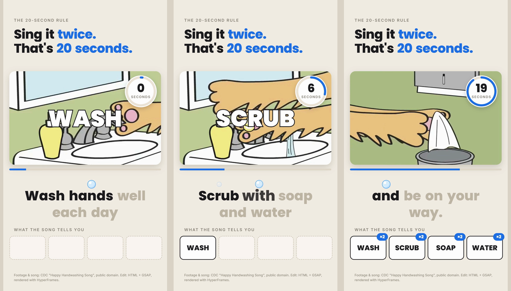

# claude-code-character-videos

Make a short vertical video with an AI character in seven steps, driven by Claude Code. The hero example skips the AI part: it cuts 30 seconds of WING IT!, Blender Studio's open movie, into a vertical video and lays a pre-flight checklist over it that the flight ignores. The whole edit is one HTML file of 227 lines, and the 32.5-second video renders on a 2014 desktop in 1 minute 43 seconds.

<p align="center">
  <a href="https://github.com/helicerat/claude-code-character-videos/releases/download/v0.1.0/wing-it.mp4"></a>
</p>

<p align="center"><a href="https://github.com/helicerat/claude-code-character-videos/releases/download/v0.1.0/wing-it.mp4"><b>Watch the full 32.5 s video with sound</b></a> (MP4, 27.3 MB, release asset). Footage and sound: WING IT! (CC) Blender Foundation | studio.blender.org, CC BY 4.0, cut to 9:16 and edited. Two more examples further down: <a href="https://github.com/helicerat/claude-code-character-videos/releases/download/v0.1.0/spin-count.mp4">spin-count.mp4</a> (21.5 s, counting the spins of an AI-generated boy) and <a href="https://github.com/helicerat/claude-code-character-videos/releases/download/v0.1.0/handwash-song.mp4">handwash-song.mp4</a> (30.8 s, karaoke on a public-domain cartoon).</p>

## What this is

The full pipeline for a short vertical video with an AI character, a mascot that sings a counting song or a coach that talks you through three moves: pick an idea, design a character, write and generate a song or a voice, animate the character, take timings from the words, the beat or the picture, write the motion-graphics edit as code (HTML + GSAP), and render it to MP4 with [HyperFrames](https://github.com/heygen-com/hyperframes) (HeyGen, Apache-2.0). Claude Code drives every step, with a chapter, a prompt and a skill that stops for you before anything costs money.

**An honest note about the examples.** All three were made without generation credits, so all three skip steps 2 to 4 (character, song, animation) and use existing footage instead. `examples/wing-it`, the GIF above, cuts 30 seconds of Blender Studio's open movie WING IT! (CC BY 4.0) into 12 vertical shots and lays a checklist over the story; its timings are story events read from frames, with no words and no beat grid. `examples/spin-count` puts a counting edit on a Pixabay stock clip of an animated 3D boy, which its Pixabay page labels AI generated, with a Pixabay music track; its timings are a beat grid and ten spin marks read from frames. `examples/handwash-song` puts a karaoke edit on CDC's public-domain "Happy Handwashing Song" cartoon; its timings are word timestamps from Whisper, aligned to the lyrics. Step 1, the idea, was a one-liner each time: a checklist that the flight ignores; count his spins; count the 20 seconds the song takes. All three run steps 5 to 7 (timings, the edit, the render) in full, and you can reproduce them with no API key and no paid service. The chapters and prompts for steps 1 to 4 are written from provider docs and model schemas. **We have not run them.**

## The pipeline

| Step | What you get | Chapter | Prompt | Costs money? (list-price estimates, 2026-10-09) |
|---|---|---|---|---|
| 1. Idea | a format that already has views, scored; `BRIEF.md` | [01-idea](docs/01-idea.md) | [gen-00-idea](prompts/generate/gen-00-idea.md) | no |
| 2. Character | design sheet, one-face reference, canon text, one keyframe per scene | [02-character](docs/02-character.md) | [gen-01-character](prompts/generate/gen-01-character.md), [gen-02-keyframes](prompts/generate/gen-02-keyframes.md) | yes: Nano Banana Pro $0.134 per image; about $0.94 for a sheet and six keyframes, about $1.60 to $2.40 with a base image, edits, two sheets and 8 to 10 keyframes |
| 3. Song or voice | `lyrics.txt`, takes checked word by word against it | [03-song-or-voice](docs/03-song-or-voice.md) | [gen-03-song](prompts/generate/gen-03-song.md), [gen-06-talking](prompts/generate/gen-06-talking.md) | yes: Lyria $0.04 to $0.08 per take; Eleven v3 or v4 voice $0.08 per 1,000 characters |
| 4. Animation | one singing, talking or moving clip per scene | [04-animate](docs/04-animate.md) | [gen-04-cut-song](prompts/generate/gen-04-cut-song.md), [gen-05-animate](prompts/generate/gen-05-animate.md), [gen-06-talking](prompts/generate/gen-06-talking.md) | yes, most of the bill: Seedance 2.5 about $0.10 to $0.57 per second, OmniHuman 1.5 $0.16 per second |
| or: existing footage | a clip and a song you may use, in place of steps 2 to 4 | [05-or-use-existing-footage](docs/05-or-use-existing-footage.md) | [00-brief](prompts/00-brief.md), [edit/01-assets](prompts/edit/01-assets.md) | no |
| 5. Timings | word timings in `transcript.json` (times from Whisper, words from your lyrics), or story events, beats and marks read from frames for a video without words | [06-word-timing](docs/06-word-timing.md) | [edit/02-word-timing](prompts/edit/02-word-timing.md) | free locally; about $0.001 per song on Groq |
| 6. The edit | one HTML + GSAP composition, reviewed by a second agent | [07-the-edit](docs/07-the-edit.md) | [edit/03-edit](prompts/edit/03-edit.md), [edit/04-review](prompts/edit/04-review.md) | no (your Claude plan) |
| 7. Render | the MP4, plus a GIF preview | [08-render-and-qa](docs/08-render-and-qa.md) | [edit/05-render](prompts/edit/05-render.md) | no |

> **Estimates from list prices, one pass, no rejected takes. We did not run or pay for the generation steps.** A 30-second singing mascot comes to about $4.3 to $15.4, most of it for animation; the range depends on the Seedance resolution and provider. A talking coach comes to about $3.8. Rejected takes are not in these figures; our rough guess is two to three times as much once retakes are counted. The arithmetic is in [docs/00-how-it-works.md](docs/00-how-it-works.md#estimated-cost-of-one-video).

How the steps fit together, and how Claude Code reaches the paid models (Picsart CLI, Higgsfield, fal, all logged into by you): [docs/00-how-it-works.md](docs/00-how-it-works.md).

## The examples

| | wing-it (the hero) | spin-count | handwash-song |
|---|---|---|---|
| Footage | Blender Studio's open movie WING IT!, CC BY 4.0: 30 s in 12 shots, each cropped to 9:16 around its subject, one kept 16:9 as a card | Pixabay stock clip of an animated 3D boy, labelled AI generated, slowed to 0.85x, full frame | CDC public-domain cartoon, in a card |
| Sound | the film's own soundtrack, one swear turned down | a Pixabay music track | the clip's own song |
| Timings | 6 checklist events and 7 gadgets read from frames (`events.json`), the cut in `shots.json` | a beat grid from `npx hyperframes beats` and ten spin marks read from frames | word timestamps from Whisper, aligned to `lyrics.txt` |
| Edit | a checklist whose chips tick or cross on story events, a countdown, an altitude meter, warnings, a gadget counter, a tape, a score card on a freeze frame | counter pills, a number per spin that flies into its pill, stickers, a title on the beat | karaoke, a timer ring, key words that fly into a board |
| Length | 32.5 s | 21.5 s | 30.8 s |
| Template | 227 lines, copied to `index.html` as is | 132 lines, copied to `index.html` as is | 216 lines, transcript inlined by `build.mjs` |

### wing-it: a checklist against the story

A cat and a dog fly a home-made rocket: a countdown, a hole in the barn roof, the moon, an umbrella instead of a parachute, seven emergency gadgets, a rooster through the windshield. The edit is a pre-flight checklist card that the story fills in, one event at a time. Every effect is a few lines of GSAP in [`examples/wing-it/build/index.template.htm`](examples/wing-it/build/index.template.htm), and every time in it is a story event read from the frames, or a fixed offset from one.

- **A 9:16 cut of a 16:9 film.** `scripts/fetch-wing-assets.mjs` trims the film at its own 12 shot changes and crops each shot to a 608x1080 window around its subject, listed in [`shots.json`](examples/wing-it/shots.json). The one shot where gadgets fly across the whole width stays 16:9, as a card over a blurred copy of itself. How: [docs/05-or-use-existing-footage.md](docs/05-or-use-existing-footage.md#a-blender-open-movie-the-wing-it-example).
- **Times from story events.** `ITEMS` holds the six checklist items with the second each one is decided, and `GADGETS` the seven gadgets ([L114-L123](examples/wing-it/build/index.template.htm#L114-L123)). The record, with what each frame shows, is [`events.json`](examples/wing-it/events.json). How to step through frames for events: [docs/06-word-timing.md](docs/06-word-timing.md#story-events-stepping-through-frames).
- **Chips that tick or cross.** At its event each chip's dot turns green with a tick or red with a cross and the chip bumps; on a pass the score text is set to the new count ([L157-L165](examples/wing-it/build/index.template.htm#L157-L165)).
- **Countdown, flash and shake.** A giant 3, 2, 1 runs into the ignition cut, and three small helpers give a white flash, a shake of the footage and a pop-in label at any time ([L141-L151](examples/wing-it/build/index.template.htm#L141-L151), [L167-L174](examples/wing-it/build/index.template.htm#L167-L174)).
- **Altitude meter, warnings, a parachute card.** A bar fills while a number counts to 12,000 FT; three red warnings blink in the red cockpit; a NEXT STEP card turns into RESULT / PARACHUTE: FAILED ([L176-L199](examples/wing-it/build/index.template.htm#L176-L199)).
- **Gadget counter and a tape.** A big number counts the seven gadgets as they fly out, each with a chip, and a BIRD STRIKE tape slams across the frame with the rooster ([L201-L213](examples/wing-it/build/index.template.htm#L201-L213)).
- **Outro on a still.** When the footage ends at 29.96 s, its last frame stays on screen as an image, a shade darkens it, and the score comes in: CHECKLIST 3/6, GADGETS 7, BIRDS 1 ([L215-L220](examples/wing-it/build/index.template.htm#L215-L220)).
- **Credit line** at the bottom of the frame ([L108](examples/wing-it/build/index.template.htm#L108)).

Measured on Windows 10 Pro, Intel i7-4790 (8 threads), 16 GB RAM, GTX 1650 4 GB, Node 24.18.0, ffmpeg 8.1.2, `hyperframes@0.8.143`:

| | |
|---|---|
| Video | 1080x1920, 30 fps, 32.500 s, 975 frames, H.264 + AAC 48 kHz stereo |
| Footage | WING IT! from Wikimedia Commons, 1920x1080, 24 fps, 237.948 s; film 1:22 to 1:52 in 12 shots, 30 fps: 29.967 s. The fetch script's `wing_v.mp4`, `wing_a.mp3` and `last.jpg` are byte for byte the files the posted video was rendered from |
| Timings | 6 checklist events and 7 gadgets read by eye, then checked with frame grabs: two checks land on a cut a little before the action and two a little after it (see the [example's Known issues](examples/wing-it/README.md#known-issues)) |
| Edit | 227 lines; lint 0 errors, 1 warning (`nested_structure_needs_subcomposition`, Studio timeline view only) |
| Render | 1 min 43.3 s for `-q delivery` (HyperFrames summary, drawElement capture), 110 s wall clock, plus 42.4 s for the right-edge fix |
| Right-edge fix | the 8 px strip at x 1072 to 1079; footage reaches the edge (79 to 136 luma levels of spread), so `fix-right-edge.mjs` picked smear |
| Files | raw render 34,624,061 bytes; after the fix 27,310,022 bytes; GIF preview 3,228,266 bytes at 12 fps and 128 colors |

Step by step: [examples/wing-it/README.md](examples/wing-it/README.md).

### spin-count: counting what you see

<p align="center">
  <a href="https://github.com/helicerat/claude-code-character-videos/releases/download/v0.1.0/spin-count.mp4"></a>
</p>

<p align="center"><a href="https://github.com/helicerat/claude-code-character-videos/releases/download/v0.1.0/spin-count.mp4"><b>Watch the full 21.5 s video with sound</b></a> (MP4, about 33 MB, release asset). Footage: TonyDias7, music: AudioCoffee, both from Pixabay under the Pixabay Content License.</p>

An animated 3D boy hops and turns in front of a gradient backdrop. Each time his back faces the camera, the edit counts a spin. Every effect is a few lines of GSAP in [`examples/spin-count/build/index.template.htm`](examples/spin-count/build/index.template.htm), and every time in it is a spin mark, a beat, or a fixed offset from one.

- **Times without words.** `SPINS` holds ten marks read by eye in the source clip, divided by 0.85 because the footage plays at 0.85x; `BEAT0` and `BEAT` are the beat grid ([L71-L77](examples/spin-count/build/index.template.htm#L71-L77)). The raw data is committed next to them: [`spins.json`](examples/spin-count/spins.json) and the beat file. How to read marks from frames with Claude Code: [docs/06-word-timing.md](docs/06-word-timing.md#timings-without-words-beats-and-visual-marks).
- **Ten counter pills.** Positions are arithmetic on three constants: 84 px pills, 12 px gaps, centered ([L80-L88](examples/spin-count/build/index.template.htm#L80-L88)).
- **A number for each spin flies into its pill.** It pops over him 0.12 s before the mark, then flies to its pill's center, `(66 + 96 * i + 42, 162)`, while it shrinks to 17 percent; on arrival the pill turns yellow and bumps ([L103-L113](examples/spin-count/build/index.template.htm#L103-L113)).
- **A sticker for each spin.** SPIN!, AGAIN!, WHOOSH! and seven more pop at his feet, tilted one way and then the other ([L114-L116](examples/spin-count/build/index.template.htm#L114-L116)).
- **The title pulses on every second beat**, 31 times ([L98-L101](examples/spin-count/build/index.template.htm#L98-L101)).
- **Outro.** The footage ends at 19.66 s, a dark card fades in, "10 / spins in 20 seconds / how many did you count?" comes in, and the pills, drawn above the card, bounce one by one ([L121-L126](examples/spin-count/build/index.template.htm#L121-L126)).
- **Credit line** at the bottom of the frame ([L61](examples/spin-count/build/index.template.htm#L61)).

Measured on Windows 10 Pro, Intel i7-4790 (8 threads), 16 GB RAM, GTX 1650 4 GB, Node 24.18.0, ffmpeg 8.1.2, `hyperframes@0.8.143`:

| | |
|---|---|
| Video | 1080x1920, 30 fps, 21.500 s, 645 frames, H.264 + AAC 48 kHz stereo |
| Footage | Pixabay clip 2160x3840, 24 fps, 16.708 s, scaled to 1080x1920 and slowed to 0.85x: 19.667 s. The fetch script's `boy.mp4` and `music_cut.mp3` are byte for byte the files the posted video was rendered from |
| Timings | 69 beats, mean spacing 0.3191 s (188 bpm); ten spin marks from 2.24 s to 19.06 s. A second pass over the frames found two more back views with no mark, so the count of ten is a judgment call (see Known issues) |
| Edit | 132 lines; lint 0 errors, 1 warning (`nested_structure_needs_subcomposition`, Studio timeline view only) |
| Render | 94 s for `-q delivery` (HyperFrames summary, screenshot capture), plus 36 s for the right-edge fix; re-rendered from this repo |
| Right-edge fix | an 8 px black strip at x 1072 to 1079, as in every render on this machine (see the FAQ); `fix-right-edge.mjs` sees the gradient next to it (68 to 76 luma levels of spread down the frame) and repeats column 1071 instead of padding a flat color, which would show a seam. 35.6 s; untouched columns 50.7 dB PSNR on average against the raw render; audio identical |
| Files | raw render 42,056,090 bytes; after the fix 33,237,084 bytes for the posted file (CRF 16 on grainy full-frame footage); GIF preview 4,048,679 bytes at 12 fps and 128 colors, from the corrected render |

Step by step: [examples/spin-count/README.md](examples/spin-count/README.md).

### handwash-song: words that light up when sung

<p align="center">
  <a href="https://github.com/helicerat/claude-code-character-videos/releases/download/v0.1.0/handwash-song.mp4"></a>
</p>

<p align="center"><a href="https://github.com/helicerat/claude-code-character-videos/releases/download/v0.1.0/handwash-song.mp4"><b>Watch the full 30.8 s video with sound</b></a> (MP4, 7.0 MB, release asset). Footage and song: CDC "Happy Handwashing Song", public domain. Not endorsed by CDC.</p>



<sub>Frames at 3.4 s, 9.1 s and 22.3 s of the handwash render. Footage and song: CDC "Happy Handwashing Song", public domain. Not endorsed by CDC.</sub>

A cartoon cat washes its paws while singers perform a four-line verse twice, to the tune of Happy Birthday. Every effect is a few lines of GSAP in [`examples/handwash-song/build/index.template.htm`](examples/handwash-song/build/index.template.htm), and every moment tied to the song reads its time from `transcript.json`. Swap in another transcript and the effects follow it.

- **Headline rises word by word out of a mask.** Each word sits in an `overflow: hidden` row and tweens `yPercent: 110 -> 0`, 0.12 s apart ([L150-L153](examples/handwash-song/build/index.template.htm#L150-L153)).
- **Footage card.** A muted `<video>` inside a 1000x617 card; the song plays from a separate `<audio id="song">`. HyperFrames plays and seeks both from their `data-*` attributes, so no script touches them ([L75-L78](examples/handwash-song/build/index.template.htm#L75-L78)).
- **Progress bar.** `scaleX` from 0 to 1 over the full 30.8 s ([L160-L161](examples/handwash-song/build/index.template.htm#L160-L161)).
- **20-second timer ring and counter.** An SVG `stroke-dashoffset` and a number, both running from the first sung word (2.98 s) to the end of the last one (24.48 s). The number is the element's `textContent`, tweened and rounded by GSAP's `snap`, so no callback writes to the page. The counter stops at 21 ([L163-L169](examples/handwash-song/build/index.template.htm#L163-L169)).
- **Giant "1" and "2" before each pass.** A `back.out` pop 1.05 s before word 0 and 0.75 s before word 19, the first word of the second pass ([L171-L176](examples/handwash-song/build/index.template.htm#L171-L176)).
- **Karaoke, one line at a time.** At each `word.start` the word turns dark and scales to 110 percent, and a soap bubble pops above it ([L178-L191](examples/handwash-song/build/index.template.htm#L178-L191)).
- **WASH, SCRUB, SOAP, WATER fly into a 4-slot board.** Each pops over the footage when first sung, flies to a slot whose position is plain arithmetic on constants, and gets an "x2" badge when sung again ([L193-L206](examples/handwash-song/build/index.template.htm#L193-L206)).
- **Outro.** "2 times through / 21 seconds of singing" fades in 0.6 s after the last sung word ([L208-L210](examples/handwash-song/build/index.template.htm#L208-L210)).
- **Credit line** at the bottom of the frame for the whole video ([L101](examples/handwash-song/build/index.template.htm#L101)).

All of it runs on one paused GSAP timeline registered as `window.__timelines.main`, with no `Math.random`, `Date.now` or timers, and GSAP 3.14.2 loaded from a local file. HyperFrames seeks that timeline to each frame and captures it.

Measured on the same machine:

| | |
|---|---|
| Video | 1080x1920, 30 fps, 30.800 s, 924 frames, H.264 + AAC 48 kHz stereo |
| Word timings | Groq `whisper-large-v3` heard 39 words for 38 sung ones: "Wash and sell" for "Wash hands well" on both passes, and a "you" at 30.16 s after the music stopped. The aligner kept 34, corrected 4, dropped 1; singing runs 2.98 s to 24.48 s |
| Edit | 216 lines; lint 0 errors, 2 warnings (`nested_structure_needs_subcomposition`, Studio timeline view only) |
| Render | 64.6 s in the latest run (HyperFrames' summary line, drawElement capture), 86.8 s wall clock for all of `npm run render`; 55.3 s for a second render with the extracted-frame cache warm. An earlier version of the template, whose counter was written by a callback, failed HyperFrames' capture check, fell back to screenshots and took 109 to 133 s |
| Right-edge fix | every render here has an 8 px black strip at x 1072 to 1079, from an FFmpeg 8.1.2 conversion bug that HyperFrames triggers (see the FAQ); `scripts/fix-right-edge.mjs` sees a flat page next to the strip (4 luma levels of spread) and fills it with the page color, in about 11 to 25 s. The untouched 1072 columns keep 53.1 dB PSNR on average (48.7 dB for the worst frame) against the raw render; the audio is copied |
| Files | raw render 9,666,279 bytes; after the fix 7,037,382 bytes (both change by a few KB between renders); GIF preview 1,934,912 bytes |
| Determinism | two full renders: 530 of 924 frames identical, the rest at 51.6 dB PSNR or better (invisible), audio identical |
| Sync | the music stops at 25.160 s in both `song.mp3` and the render |

Step by step: [examples/handwash-song/README.md](examples/handwash-song/README.md).

## Quickstart (the examples)

You need Node 22 or newer, ffmpeg and ffprobe on PATH, and network access on the first run (npm, Wikimedia Commons, the Pixabay CDN, jsDelivr, Google Fonts, the Chrome download). There is nothing to `npm install`: the scripts have no dependencies, and HyperFrames runs through npx, pinned to 0.8.143.

```bash
git clone https://github.com/helicerat/claude-code-character-videos.git
cd claude-code-character-videos

# every shell that runs HyperFrames: telemetry is on by default
export HYPERFRAMES_NO_TELEMETRY=1          # PowerShell: $env:HYPERFRAMES_NO_TELEMETRY = "1"

# once per machine
npx hyperframes@0.8.143 browser ensure     # downloads Chrome Headless Shell for rendering
npx hyperframes@0.8.143 doctor             # checks Node, FFmpeg, FFprobe, Chrome and optional extras

# wing-it
npm run fetch:wing     # downloads WING IT! from Wikimedia Commons (36.2 MB), makes wing_v.mp4, wing_a.mp3 and last.jpg, probes them
npm run build:wing     # copies the template to index.html
npm run lint:wing      # expect 0 errors and 1 warning
npm run render:wing    # -> renders/wing-it.raw.mp4, then the right-edge fix -> renders/wing-it.mp4
npm run probe:wing

# spin-count
npm run fetch:spin     # downloads the Pixabay clip (52.5 MB) and track (4.0 MB), makes boy.mp4 and music_cut.mp3, probes them
npm run build:spin     # copies the template to index.html
npm run lint:spin      # expect 0 errors and 1 warning
npm run render:spin    # -> renders/spin.raw.mp4, then the right-edge fix -> renders/spin.mp4
npm run probe:spin

# handwash-song
npm run fetch      # downloads the CDC clip (2.9 MB) and GSAP, makes cat.mp4 and song.mp3, probes them
npm run align      # assets/whisper_verbose.json + lyrics.txt -> transcript.json (38 words)
npm run build      # template + transcript -> index.html
npm run lint       # expect 0 errors and 2 warnings
npm run render     # -> renders/handwash-song.raw.mp4, then the right-edge fix -> renders/handwash-song.mp4
npm run probe      # duration, fps, frames, sample rate of the inputs and both renders
```

`npm run fetch:wing` took 51 to 55 s here, 43 to 46 s of it the footage encode, and made `wing_v.mp4`, `wing_a.mp3` and `last.jpg` byte for byte the files the posted video was rendered from. The film is under CC BY 4.0, so you may share it with credit; the repo still keeps it and everything cut from it out of git, like the other examples' media. `npm run probe:wing` warns that the files differ in length: the footage ends at 29.97 s and the outro holds its last frame to 32.5 s, by design.

`npm run fetch:spin` took 56 s here, most of it the `boy.mp4` encode. It copies GSAP from the handwash example when that is there, and downloads it from jsDelivr otherwise. The two Pixabay files are free to use and edit but may not be redistributed unedited, so they and everything cut from them stay out of git; the script checks their sizes and sha256. To download them by hand instead, see `node scripts/fetch-spin-assets.mjs --help`.

The first `npx hyperframes@0.8.143` call asks "Need to install the following packages ... Ok to proceed?"; answer `y`. On our machine `doctor` ended with "Some checks failed" and exit code 0: the lines for whisper-cpp, TTS (Kokoro), BGM (MusicGen) and Docker are optional extras that no example needs.

To watch the composition in the browser, run HyperFrames Studio on its own:

```bash
npm run preview        # handwash-song; Ctrl+C to stop; in the background: npx hyperframes@0.8.143 preview examples/handwash-song --stop
npm run preview:spin   # spin-count
npm run preview:wing   # wing-it
```

Studio writes `data-hf-id` attributes into every `*.html` composition file in the project folder, so after a preview `index.html` shows up as changed in `git status`. Run `npm run build`, `npm run build:spin` or `npm run build:wing` to regenerate it (or `git checkout -- examples/<name>/index.html`), and read `git diff` before you commit. The template ends in `.htm` so that Studio leaves it alone.

- **Optional transcription.** The Groq output is committed, so `align` works offline. To redo it, set `GROQ_API_KEY` and run `npm run transcribe` before `align`. It uploads `song.mp3` to Groq and overwrites `assets/whisper_verbose.json`. At Groq's list price of $0.111 per audio hour ([Groq docs](https://console.groq.com/docs/speech-to-text)) the 31-second song costs about a tenth of a cent.
- **Telemetry.** The npm scripts cannot set the variable on every OS, so export it yourself, or turn telemetry off for good with `npx hyperframes@0.8.143 telemetry disable`.
- **Behind a proxy.** `npx` uses `npm_config_https_proxy`. The Node scripts download with Node's built-in `fetch`, which ignores `HTTPS_PROXY` unless `NODE_USE_ENV_PROXY=1` is also set (tested on Node 24.18.0; older Node 22 releases may not support it).

Each script has `--help`.

## Make your own

Before entry A: log into one generation service ([how Claude Code reaches the paid models](docs/00-how-it-works.md#how-claude-code-reaches-the-paid-models)), budget about $4 to $15 per pass (an estimate; two to three times that with retakes), and run an example once so you know the toolchain works.

- **The skill.** [`skills/character-video`](skills/character-video/SKILL.md) runs the whole pipeline from either entry point: (A) generate the character, the song and the clips, with the price stated and your OK before every paid call and every take logged in `costs.csv`, or (B) bring existing footage and a song, a music track or the footage's own sound. Both continue with timings (word timings for lyrics; story events, beats or marks read from frames for a video without words, as in wing-it and spin-count), the edit, a reviewer pass, the render and the edge fix, and stop for your approval after the brief, after the timings, before any render, and before the final render. Copy it into your Claude Code skills folder and start a new session:

  ```bash
  mkdir -p ~/.claude/skills && cp -r skills/character-video ~/.claude/skills/
  ```

  PowerShell:

  ```powershell
  New-Item -ItemType Directory -Force "$HOME\.claude\skills" | Out-Null; Copy-Item -Recurse skills\character-video "$HOME\.claude\skills\"
  ```

  Then ask for it by name ("use character-video on examples/my-video") or describe the job ("make a video with an AI mascot that sings", "make a lyric video from this clip and song", "count the jumps in this clip and put it to this track", "put a checklist over this short-film scene and tick it as things happen").
- **The prompts.** [prompts/](prompts/README.md) has the same steps as separate prompts to paste one at a time: seven generation prompts in `prompts/generate/` (not run by us), a shared brief, and five edit prompts in `prompts/edit/`. Their commands and reference numbers come from the handwash example; the prompts as written have not been run end to end on new material.
- **The HyperFrames plugin** is optional: `claude plugin marketplace add heygen-com/hyperframes`, then `claude plugin install hyperframes@hyperframes`. On our Windows machine the first command failed with `EBUSY` on a half-cloned folder; restarting Claude Code and running it again worked.

## Repo map

```
README.md                      this file
LICENSE                        MIT
THIRD_PARTY_NOTICES.md         HyperFrames, GSAP, fonts, Blender, Pixabay and CDC media, transcription, generation services
CLAUDE.md, AGENTS.md           rules for coding agents in this repo (same content)
package.json                   npm scripts; no dependencies
docs/
  00-how-it-works.md           the seven steps, what costs money, how Claude Code reaches the models
  01-idea.md                   step 1: a format that already has views, scorecard, money, red flags
  02-character.md              step 2: design a recurring character, keep it identical, keyframes
  03-song-or-voice.md          step 3: lyrics or script, takes, the word-by-word check
  04-animate.md                step 4: singing, talking and moving clips, limits, list prices
  05-or-use-existing-footage.md  the free way in: license checks (public domain, CC BY, Pixabay), cropping, a 9:16 cut of a 16:9 film, ffmpeg flags
  06-word-timing.md            step 5: word timestamps, the misheard lyric, alignment; story events, beats and marks read from frames
  07-the-edit.md               step 6: the composition, layer by layer, for all three examples
  08-render-and-qa.md          step 7: lint, snapshots, render, right-edge fix (fill or smear), probe, determinism, GIFs
  gotchas.md                   every pitfall in one list
  img/demo-wing.gif            wing-it preview, 2.6 to 9.6 s of the render posted on X
  img/demo-spin.gif            spin-count preview, 1.0 to 8.4 s of its corrected render
  img/demo.gif, img/hero.png   handwash-song previews made from the fixed render (before the CDC end card)
prompts/
  README.md                    index of all prompts
  00-brief.md                  shared brief for both entry points
  generate/gen-00 ... gen-06   idea, character, keyframes, song, cut, animate, talking (not run by us)
  edit/01 ... 05               assets, word timing, edit, review, render
skills/character-video/SKILL.md  the Claude Code skill for the whole pipeline
scripts/                       Node ESM, no dependencies, each with --help
  fetch-assets.mjs             handwash-song: downloads the CDC clip and GSAP (sha256-pinned), makes cat.mp4 and song.mp3
  fetch-spin-assets.mjs        spin-count: downloads the Pixabay clip and track (size- and sha256-checked), makes boy.mp4 and music_cut.mp3
  fetch-wing-assets.mjs        wing-it: downloads WING IT! from Commons (size- and sha256-checked), cuts it by shots.json into wing_v.mp4, wing_a.mp3, last.jpg
  transcribe-groq.mjs          word timestamps from Groq whisper-large-v3 (needs GROQ_API_KEY)
  align-lyrics.mjs             ASR times + lyrics.txt words -> transcript.json, with a report
  build.mjs                    inlines transcript.json into the template -> index.html (copies it when there is no transcript)
  fix-right-edge.mjs           finds a black strip at the right edge of a render and fills it (flat fill or smear, picked from the picture)
  probe.mjs                    duration, fps, frames, sample rate and channels of any media file
  check-links.mjs              checks every relative link and anchor in the Markdown files
  framemd5-diff.mjs            frame-by-frame comparison of two videos
  lib.mjs                      shared helpers
examples/wing-it/
  shots.json                   the 12 shots of the 9:16 cut: film times and crop centers (committed, read by the fetch script)
  events.json                  the story events the edit reacts to, with what each frame shows (committed)
  build/index.template.htm     the edit; the file to change
  index.html                   copied from the template by scripts/build.mjs; do not edit
  README.md, CREDITS.md        reproduce steps, numbers, sources, license notes
  assets/source/, assets/*.mp4, *.mp3, *.jpg, gsap.min.js, renders/, snapshots/   made on your machine, gitignored
examples/spin-count/
  spins.json                   the ten spin marks (committed)
  beats/assets/music_cut.mp3.json  raw output of npx hyperframes beats (committed)
  build/index.template.htm     the edit; the file to change
  index.html                   copied from the template by scripts/build.mjs; do not edit
  README.md, CREDITS.md        reproduce steps, numbers, sources, license notes
  assets/source/, assets/*.mp4, *.mp3, gsap.min.js, renders/, snapshots/   made on your machine, gitignored
examples/handwash-song/
  lyrics.txt                   the words as sung
  assets/whisper_verbose.json  raw Groq output (committed)
  transcript.json              38 aligned words (committed)
  build/index.template.htm     the edit; the file to change (.htm, so HyperFrames Studio does not rewrite it)
  index.html                   generated by scripts/build.mjs; do not edit
  README.md, CREDITS.md        reproduce steps, numbers, sources
  assets/*.mp4, *.mp3, gsap.min.js, renders/, snapshots/   made on your machine, gitignored
```

## FAQ and limits

**Did you run the generation steps?** No. All three examples were made without generation credits. The chapters and prompts for the idea, the character, the song and the animation are built from provider docs and model schemas, each linked where it is used. Expect to tune them, and check prices before you pay.

**How does rendering behave on Windows?** HyperFrames captures frames with Chrome's BeginFrame on Linux. Elsewhere it captures screenshots, and tries a faster drawElement path first where that can engage: `render --help` in 0.8.143 says macOS with a hardware GPU, and our Windows machine with a GPU tried it too ([CLI reference](https://hyperframes.heygen.com/packages/cli)). The drawElement path checks four frames against reference screenshots and captures the whole video again with screenshots if one falls below 32 dB. Our first template failed that check at frame 693 (31.7 dB): its timer counter was written by an `onUpdate` callback, and the reference screenshot showed the counter at 0 where the drawElement frame showed 20. With the counter tweened as `textContent` the check passes (52.6, 49.8, 49.0 and 49.0 dB), and a delivery render of the handwash example takes 64.6 s instead of 109 to 133 s. Keep timeline callbacks from writing to the page. (The wing-it template still writes its altitude number from `onUpdate`, and its render passed the check anyway, in 1 min 43.3 s. Do not count on that.)

**What is the black strip at the right edge?** Every render on our machine has its last 8 columns (x 1072 to 1079) black. The cause is a bug in FFmpeg 8.1.2, seen with the gyan.dev Windows build we use, and HyperFrames triggers it: ffmpeg's x86 SIMD conversion from yuv420p (also yuvj420p and yuv422p) to the gbrp pixel format leaves every column after the last multiple of 16 black, and HyperFrames 0.8.143 runs every captured frame through that conversion. One line reproduces it: `ffmpeg -f lavfi -i "color=c=white:s=1080x64,format=yuv420p" -frames:v 1 -vf format=gbrp out.png` gives black columns 1072 to 1079, and the same command with `-cpuflags 0` gives a clean image. Snapshots skip ffmpeg, so they never show it. Other ffmpeg builds and operating systems are untested; `HYPERFRAMES_FFMPEG_PATH` points HyperFrames at another build if you want to try one. HyperFrames extracts video frames through the same conversion, so footage gets a band at its own right edge too unless its width is a multiple of 16 (the handwash `cat.mp4` is 1088 wide for that reason; the spin-count and wing-it footage fills the frame, so its band falls on the same 8 columns). `npm run render`, `npm run render:spin` and `npm run render:wing` repair the render with `scripts/fix-right-edge.mjs`, which re-encodes the video and copies the audio. Next to a flat page, as in handwash-song, it pads the strip with the page color; next to footage or a gradient, as in spin-count and wing-it, it repeats column 1071 into the strip, because a flat fill there shows as a seam. Run `node scripts/fix-right-edge.mjs <file> --dry-run` on your own renders; with no strip it changes nothing. Details: [docs/08-render-and-qa.md](docs/08-render-and-qa.md#5-fix-the-right-edge).

**Are renders deterministic?** Each frame is a seek to a frame number, so the same composition should give the same frames ([determinism](https://hyperframes.heygen.com/concepts/determinism)). Two renders of a 5-second test composition were identical, 150 of 150 frames (ffmpeg framemd5; earlier session, files not kept). Full 30.8 s renders on the same machine were not: in the latest pair, 530 of 924 frames matched. The differences run from the WASH pop (3.07 s) to the encoder keyframe at 8.33 s and from 8.80 s to the keyframe at 16.67 s, with a minimum PSNR of 51.6 dB, which you cannot see. The audio matched. Earlier pairs, made with the callback counter and screenshot capture, matched on 520 to 529 frames (earlier session, files not kept). HyperFrames offers `render --docker` for reproducible output; we have no Docker on this machine and did not test it. `node scripts/framemd5-diff.mjs a.mp4 b.mp4` runs the comparison.

**Can I use a song transcript as is?** Use its timings and check its words. Speech models mishear singing: ours turned "hands well" into "and sell" twice and invented a word over silence. HyperFrames' own guidance for songs treats a transcript with more than 20 percent music-note tokens as failed ([transcript-handling.md](https://github.com/heygen-com/hyperframes/blob/main/skills/media-use/audio/references/captions/transcript-handling.md)). Keep `lyrics.txt` as the source of truth and read the aligner's "not heard" list: on a generated song, a missing word usually means the take skipped it.

**Why is HyperFrames pinned to 0.8.143?** It is the version our renders were made with. HyperFrames releases several times a day (17 releases, v0.8.127 to v0.8.143, are dated 5 to 8 October 2026 on the [releases page](https://github.com/heygen-com/hyperframes/releases)), and its docs disagree with each other in places, for example on the default `--quality`. Bare `npx hyperframes` would pull whatever is newest. To upgrade, change the version everywhere, lint, compare snapshots, rerun the framemd5 check, check the right edge and update the measured numbers. After any ffmpeg change, run the one-line repro above again.

**Is `npx hyperframes transcribe` safe to run here?** With care. In 0.8.143 it writes `transcript.json` into `--dir`, or next to the input file when `--dir` is not given, and in each `.html` file under that folder it rewrites the first `const script = [...]` or `const TRANSCRIPT = [...]` it finds with the raw, misheard words. Run on `assets/song.mp3` it only writes `assets/transcript.json`. Never point `--dir` at an example folder: that overwrites the aligned transcript and the built `index.html`. The local engines also need setup on Windows: `doctor` reports whisper.cpp missing, and Parakeet is a separate download (`npx hyperframes@0.8.143 models install parakeet`). We did not run either engine for the examples.

**What leaves my machine?** HyperFrames telemetry, unless you turn it off. `snapshot` sends frames to Gemini when `GEMINI_API_KEY` is set, so pass `--describe false`. `npx hyperframes usage` reads your Claude Code credentials, and the HyperFrames agent skill tells the agent to run it. `npm run transcribe` uploads `song.mp3` to Groq. `npm run fetch` downloads from Wikimedia Commons and jsDelivr, `npm run fetch:wing` from Wikimedia Commons (and jsDelivr if needed), `npm run fetch:spin` from the Pixabay CDN (and jsDelivr if needed), `npx hyperframes beats` analyzes the music in a local headless Chrome, and HyperFrames fetches the Poppins and Inter fonts from Google Fonts on the first compile. On the generation path, your prompts, images and audio go to the services you choose.


**Known issues in wing-it.**

- The altitude number is written into the page by an `onUpdate` callback, against the repo's own rule. The posted render passed HyperFrames' drawElement check anyway, and the template is kept as rendered ([examples/wing-it/README.md](examples/wing-it/README.md#known-issues)).
- Two checklist marks land on a cut a little before the action (IGNITION, AIRSPACE) and two a little after it (LIFTOFF, PARACHUTE), by 0.2 to 0.5 s; `events.json` says what each frame shows.
- A shouted swear at film 1:42 to 1:44 is turned down to 12 percent, not removed.
- `check` fails: the chip dots keep their tick or cross transparent until the event (by design), and contrast is short on the white tick on green (2.74:1), the RESULT label (2.07:1) and the credit line (4.27:1). `lint` passes.

**Known issues in spin-count.**

- An early render of spin-count credited the footage to the wrong Pixabay uploader; the clip's page names TonyDias7. Its first 4 frames also showed all ten pills at full size before they popped in. The template fixes both, and the GIF on this page and the release video come from the corrected render.
- The edit counts 10 spins. A second pass over the frames for this guide found 2 more moments with his back to the camera that have no mark ([examples/spin-count/README.md](examples/spin-count/README.md#known-issues)).
- The music's page says "Content ID Registered": a video with it can get a claim on platforms that run Content ID, such as YouTube (not tested).
- `check` fails on contrast: the unlit pill numbers (1.89:1 to 1.95:1, by design) and the credit line (2.91:1). `lint` passes.

**Known issues in handwash-song.**

- From 25.17 s the source cuts to its end card, which carries the CDC and HHS logos. Part of the CDC logo shows in the footage card for the last 5.6 s of the full render. The GIF and the still on this page stop before it. [docs/05-or-use-existing-footage.md](docs/05-or-use-existing-footage.md) has a tested ffmpeg command that stops the clip at 25.1 s and holds the last cat frame.
- `npx hyperframes@0.8.143 check` fails on contrast: the timer label is 3.72:1 and the credit line 2.64:1, against the 4.5:1 that WCAG AA asks for. `lint` passes.
- `cat.mp4` uses x264's default keyframe interval, so keyframes can be up to 8.33 s apart, and HyperFrames warns about sparse keyframes on every render. We found no frozen frames in the render. For your own footage, encode with `-g 30 -keyint_min 30`.

**Why are the clips not in the repo?** The Pixabay Content License lets you use and edit the clip and the track for free, commercial use included, but not distribute them "on a Standalone basis", that is, unedited. So `scripts/fetch-spin-assets.mjs` downloads both, `.gitignore` keeps them out, and only the edited render and a GIF of it are shared ([examples/spin-count/CREDITS.md](examples/spin-count/CREDITS.md)). For the CDC cartoon, a public-domain tag on Commons is the uploader's statement and does not amount to legal advice, and CDC asks reusers to credit CDC, not imply endorsement and not use its logo. So the repo ships a script and no raw CDC media: `scripts/fetch-assets.mjs` downloads the original from Commons and checks its sha256, and `.gitignore` keeps the clip and the video and audio cut from it out of commits. Two preview images derived from the render are committed (`docs/img/demo.gif`, `docs/img/hero.png`), both from before the end card. WING IT! is under CC BY 4.0, which allows sharing the film with credit; the repo keeps it out anyway, for the same reason as the rest (no media in git), and `scripts/fetch-wing-assets.mjs` cuts it on your machine ([examples/wing-it/CREDITS.md](examples/wing-it/CREDITS.md)). The full renders are distributed as release assets and stay out of the git history.

More pitfalls, from fonts to retiring model IDs: [docs/gotchas.md](docs/gotchas.md).

## Credits and license

- Code, docs, prompts and the skill: [MIT](LICENSE), copyright 2026 helicerat0x.
- wing-it footage and sound: [WING IT!](https://studio.blender.org/projects/wing-it/) by Blender Studio, (CC) Blender Foundation | studio.blender.org, under [CC BY 4.0](https://creativecommons.org/licenses/by/4.0/), via [Wikimedia Commons](https://commons.wikimedia.org/wiki/File:WING_IT!_-_Blender_Open_Movie-full_movie.webm). Cut to 9:16, one swear turned down, motion graphics added. Not in this repo. Details: [examples/wing-it/CREDITS.md](examples/wing-it/CREDITS.md). This repo is not affiliated with or endorsed by Blender Foundation.
- spin-count footage: ["Boy, Child, Kid"](https://pixabay.com/videos/boy-child-kid-childhood-dancing-313047/), uploaded by TonyDias7; music: ["Funny Dancing Kids"](https://pixabay.com/music/happy-childrens-tunes-funny-dancing-kids-158822/) by AudioCoffee (the uploader asks for "Music by AudioCoffee(Denys Kyshchuk): https://www.audiocoffee.net/" in video descriptions). Both from Pixabay under the [Pixabay Content License](https://pixabay.com/service/license-summary/); not in this repo. Details: [examples/spin-count/CREDITS.md](examples/spin-count/CREDITS.md).
- handwash-song footage and song: "Happy Handwashing Song" by the Centers for Disease Control and Prevention (CDC), public domain, via [Wikimedia Commons](https://commons.wikimedia.org/wiki/File:Happy_Handwashing_Song.webm). Details: [examples/handwash-song/CREDITS.md](examples/handwash-song/CREDITS.md). This repo is not endorsed by CDC or HHS, and the CDC logo is not used as branding.
- [HyperFrames](https://github.com/heygen-com/hyperframes) by HeyGen, Apache-2.0, run through npx and not included in this repo.
- [GSAP](https://gsap.com) 3.14.2 under the [GSAP Standard License](https://gsap.com/standard-license), downloaded by the fetch scripts and not committed.
- Quoted vendor material: [Picsart gen-ai-skills](https://github.com/PicsArt/gen-ai-skills) (MIT), Google's Gemini API docs (CC BY 4.0) and the HyperFrames docs (Apache-2.0), each credited where quoted.

Full list of third-party terms: [THIRD_PARTY_NOTICES.md](THIRD_PARTY_NOTICES.md).
