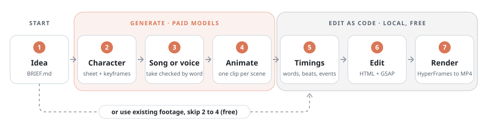
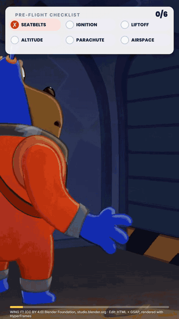
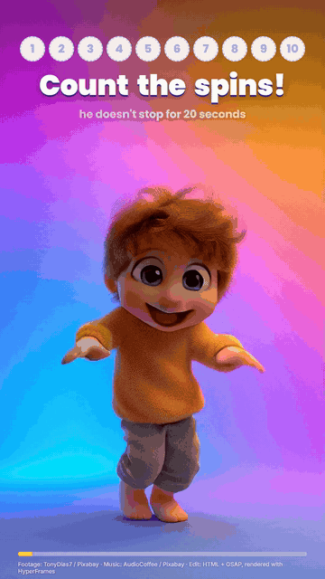
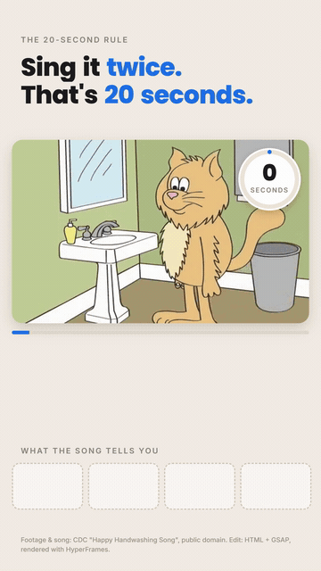

# claude-code-character-videos

A pipeline for making a short vertical video with an AI character: Claude Code drives every step, the edit is written as code (HTML + GSAP), and [HyperFrames](https://github.com/heygen-com/hyperframes) renders it to MP4.

[](LICENSE) [](package.json) [](https://github.com/heygen-com/hyperframes) [](skills/character-video/SKILL.md)

## How it works

<p align="center">
  <picture>
    <source media="(prefers-color-scheme: dark)" srcset="docs/img/pipeline-dark.svg">
    
  </picture>
</p>

Steps 2 to 4 call paid generation models. The rest is free, apart from your Claude plan and an optional Groq transcription at a fraction of a cent.

| Step (chapter) | What you get | Prompt | Cost |
|---|---|---|---|
| [1. Idea](docs/01-idea.md) | `BRIEF.md`: format, skeleton, what the edit animates | [gen-00](prompts/generate/gen-00-idea.md) | free |
| [2. Character](docs/02-character.md) | sheet, one-face reference, `CHARACTER.md`, keyframes | [gen-01](prompts/generate/gen-01-character.md), [gen-02](prompts/generate/gen-02-keyframes.md) | paid, about $0.134 per image |
| [3. Song or voice](docs/03-song-or-voice.md) | `lyrics.txt` or `script.txt`, a take checked word by word | [gen-03](prompts/generate/gen-03-song.md), [gen-06](prompts/generate/gen-06-talking.md) | paid, $0.04 to $0.08 per song take |
| [4. Animate](docs/04-animate.md) | one clip per scene | [gen-04](prompts/generate/gen-04-cut-song.md), [gen-05](prompts/generate/gen-05-animate.md), [gen-06](prompts/generate/gen-06-talking.md) | paid, about $0.08 to $0.57 per second |
| [or: existing footage](docs/05-or-use-existing-footage.md) | a clip and sound you may use, in place of 2 to 4 | [00-brief](prompts/00-brief.md), [edit/01](prompts/edit/01-assets.md) | free |
| [5. Timings](docs/06-word-timing.md) | word timings, or beats, marks and story events read from frames | [edit/02](prompts/edit/02-word-timing.md) | free, or about $0.001 per song on Groq |
| [6. Edit](docs/07-the-edit.md) | an HTML + GSAP composition, reviewed | [edit/03](prompts/edit/03-edit.md), [edit/04](prompts/edit/04-review.md) | your Claude plan |
| [7. Render](docs/08-render-and-qa.md) | the MP4 and a GIF preview | [edit/05](prompts/edit/05-render.md) | free |

List prices on 2026-10-09; check them before you pay. Overview: [docs/00-how-it-works](docs/00-how-it-works.md).

## Examples

<table>
  <tr>
    <th><a href="examples/wing-it/README.md">wing-it</a></th>
    <th><a href="examples/spin-count/README.md">spin-count</a></th>
    <th><a href="examples/handwash-song/README.md">handwash-song</a></th>
  </tr>
  <tr>
    <td align="center"><a href="https://github.com/helicerat/claude-code-character-videos/releases/download/v0.1.0/wing-it.mp4"></a></td>
    <td align="center"><a href="https://github.com/helicerat/claude-code-character-videos/releases/download/v0.1.0/spin-count.mp4"></a></td>
    <td align="center"><a href="https://github.com/helicerat/claude-code-character-videos/releases/download/v0.1.0/handwash-song.mp4"></a></td>
  </tr>
  <tr>
    <td>A pre-flight checklist over a film scene. Chips tick or cross as the story reaches each item.<br><br><b>32.5 s</b> · timed by story events<br><sub>Footage and sound: WING IT! (CC) Blender Foundation | studio.blender.org, CC BY 4.0, cut to 9:16 and edited.</sub></td>
    <td>Counts the spins of an AI-generated 3D boy. Each spin's number flies into a counter pill.<br><br><b>21.5 s</b> · timed by beats and marks<br><sub>Footage: TonyDias7, music: AudioCoffee, both from Pixabay under the Pixabay Content License.</sub></td>
    <td>Karaoke on a cartoon. Each word lights up as it is sung, and key words fly into a board.<br><br><b>30.8 s</b> · timed by word timestamps<br><sub>Footage and song: CDC "Happy Handwashing Song", public domain. Not endorsed by CDC.</sub></td>
  </tr>
</table>

Click a GIF for the MP4 with sound. All three use existing footage, so they need no API key and no paid service.

## Quickstart

You need Node 22 or newer, ffmpeg and ffprobe on PATH, and network access on the first run. Nothing to `npm install`: HyperFrames runs through npx.

```bash
git clone https://github.com/helicerat/claude-code-character-videos.git
cd claude-code-character-videos

export HYPERFRAMES_NO_TELEMETRY=1        # PowerShell: $env:HYPERFRAMES_NO_TELEMETRY = "1"
npx hyperframes@0.8.143 browser ensure   # Chrome Headless Shell, once
npx hyperframes@0.8.143 doctor           # checks the toolchain

npm run fetch:wing
npm run build:wing
npm run render:wing                      # -> examples/wing-it/renders/wing-it.mp4
```

| Example | Fetch media | Build | Lint | Preview | Render |
|---|---|---|---|---|---|
| wing-it | `fetch:wing` | `build:wing` | `lint:wing` | `preview:wing` | `render:wing` |
| spin-count | `fetch:spin` | `build:spin` | `lint:spin` | `preview:spin` | `render:spin` |
| handwash-song | `fetch` | `build` | `lint` | `preview` | `render` |

Run each with `npm run <name>`. Each `render` script renders, then fixes the right edge, in about 1.5 to 3 minutes. Lint should give 0 errors; `nested_structure_needs_subcomposition` warnings are expected.

- **Telemetry** is on by default. Export the variable in each shell, or run `npx hyperframes@0.8.143 telemetry disable` once.
- **Preview rewrites `index.html`.** Run the matching `build` script afterwards.
- **Behind a proxy**, `npx` reads `npm_config_https_proxy`; the Node scripts need `HTTPS_PROXY` plus `NODE_USE_ENV_PROXY=1`.

## Make your own

Run an example first to check your toolchain.

### Prompts, one step at a time

[prompts/](prompts/README.md) has a prompt per step. Paste them into Claude Code from the repo root, in order; each stops for you at least once. With generation, start with [`generate/gen-00-idea.md`](prompts/generate/gen-00-idea.md), run [`generate/`](prompts/generate) for steps 1 to 4, then [`00-brief.md`](prompts/00-brief.md). With existing footage, start with `00-brief.md`. Both continue with [`edit/`](prompts/edit) for steps 5 to 7.

### The skill, the whole pipeline in one go

[`skills/character-video`](skills/character-video/SKILL.md) runs either branch. It states the price and waits for your OK before every paid call, logs every take in `costs.csv`, and stops for review after the brief, after the timings and before each render.

Copy it into `~/.claude/skills/` (all projects) or `<project>/.claude/skills/` (one project), then start a new Claude Code session:

```bash
mkdir -p ~/.claude/skills && cp -r skills/character-video ~/.claude/skills/
```

```powershell
New-Item -ItemType Directory -Force "$HOME\.claude\skills" | Out-Null
Copy-Item -Recurse skills\character-video "$HOME\.claude\skills\"
```

Ask for it by name ("use character-video on examples/my-video") or describe the job.

### Paid models

Claude Code reaches them through a CLI or MCP server you log into yourself: Picsart `gen-ai`, Higgsfield or fal ([setup](docs/00-how-it-works.md#how-claude-code-reaches-the-paid-models)). Never paste a key into a prompt or a committed file.

## Repo map

```text
docs/                    one chapter per step, plus gotchas.md
examples/
  wing-it/               story events: a checklist over a film scene
  spin-count/            beats and marks: a spin counter
  handwash-song/         word timings: karaoke
prompts/                 00-brief.md, generate/ (steps 1-4), edit/ (steps 5-7)
scripts/                 Node, no dependencies, each with --help
skills/character-video/  the Claude Code skill
```

Each example holds the edit (`build/index.template.htm`), a generated `index.html`, its timing data and `CREDITS.md`.

## FAQ and limits

**What does one video cost?** At list prices, a 30-second singing mascot is about $4.5 to $15.6 per pass, mostly animation, and a talking coach about $3.8. Budget two to three times that for retakes. [Breakdown](docs/00-how-it-works.md#estimated-cost-of-one-video).

**Can I post videos made from the examples?** Each example's `CREDITS.md` gives the license, the credit line and what may be shared. Two catches: the spin-count track is registered with Content ID, so a video with it can get a claim, and the CDC clip shows the CDC and HHS logos from 25.17 s, so end the footage before that or cover it.

**What is the black strip at the right edge?** ffmpeg 8.1.2 (gyan.dev Windows build) blacks out every column after the last multiple of 16 when its x86 SIMD code converts yuv420p to gbrp, and HyperFrames 0.8.143 converts every frame that way: columns 1072 to 1079 of a 1080-wide render. The `render` scripts repair it with `scripts/fix-right-edge.mjs`, which leaves a clean file unchanged. Encode footage at a width that is a multiple of 16, like 1088. [Details](docs/08-render-and-qa.md#5-fix-the-right-edge).

**Why is HyperFrames pinned to 0.8.143?** It ships releases almost daily, and bare `npx hyperframes` pulls the newest. To upgrade, change the version everywhere, then lint, compare snapshots and check the right edge.

**Can I use a song transcript as is?** Use its timings, not its words: Whisper heard "hands well" as "and sell" in handwash-song. Keep `lyrics.txt` as the source of truth and run `npm run align`. Never point `npx hyperframes@0.8.143 transcribe --dir` at an example folder: it overwrites the aligned `transcript.json` and `index.html`.

More pitfalls: [docs/gotchas.md](docs/gotchas.md). Each example's README lists its known issues.

## Credits and license

- Code, docs, prompts and the skill: [MIT](LICENSE).
- wing-it footage and sound: [WING IT!](https://studio.blender.org/projects/wing-it/) by Blender Studio, (CC) Blender Foundation | studio.blender.org, under [CC BY 4.0](https://creativecommons.org/licenses/by/4.0/), via [Wikimedia Commons](https://commons.wikimedia.org/wiki/File:WING_IT!_-_Blender_Open_Movie-full_movie.webm). Cut to 9:16, one swear turned down, motion graphics added. Not in this repo. Details: [CREDITS.md](examples/wing-it/CREDITS.md). This repo is not affiliated with or endorsed by Blender Foundation.
- spin-count footage: ["Boy, Child, Kid"](https://pixabay.com/videos/boy-child-kid-childhood-dancing-313047/), uploaded by TonyDias7; music: ["Funny Dancing Kids"](https://pixabay.com/music/happy-childrens-tunes-funny-dancing-kids-158822/) by AudioCoffee (the uploader asks for "Music by AudioCoffee(Denys Kyshchuk): https://www.audiocoffee.net/" in video descriptions). Both from Pixabay under the [Pixabay Content License](https://pixabay.com/service/license-summary/); not in this repo. Details: [CREDITS.md](examples/spin-count/CREDITS.md).
- handwash-song footage and song: "Happy Handwashing Song" by the Centers for Disease Control and Prevention (CDC), public domain, via [Wikimedia Commons](https://commons.wikimedia.org/wiki/File:Happy_Handwashing_Song.webm). Details: [CREDITS.md](examples/handwash-song/CREDITS.md). This repo is not endorsed by CDC or HHS, and the CDC logo is not used as branding.
- [HyperFrames](https://github.com/heygen-com/hyperframes) by HeyGen, Apache-2.0, run through npx and not included in this repo.
- [GSAP](https://gsap.com) 3.14.2 under the [GSAP Standard License](https://gsap.com/standard-license), downloaded by the fetch scripts and not committed.
- Quoted vendor material: [Picsart gen-ai-skills](https://github.com/PicsArt/gen-ai-skills) (MIT), Google's Gemini API docs (CC BY 4.0) and the HyperFrames docs (Apache-2.0), each credited where quoted.

All third-party terms: [THIRD_PARTY_NOTICES.md](THIRD_PARTY_NOTICES.md).
