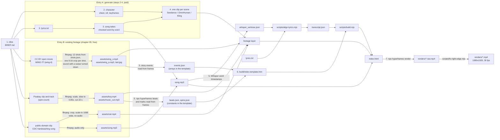

# 00. How it works

A short vertical video with an AI character is made in seven steps, and Claude Code drives all of them. Steps 1 to 4 make the media: the idea, the character, the song or voice, and the animated clips. Steps 5 to 7 put the edit on top: timings, a motion-graphics edit written as HTML + GSAP, and a render to MP4 with HyperFrames. Steps 2 to 4 call paid generation models. Steps 1 and 5 to 7 run on your machine for nothing, or for a fraction of a cent.

The repo has three worked examples, all made without generation credits, so all three skip steps 2 to 4 (character, song, animation) and use existing footage instead (chapter 05). All three run steps 5 to 7 in full:

- `examples/wing-it`, the hero: 30 seconds of WING IT!, Blender Studio's open movie (CC BY 4.0), cut at its 12 shot changes into a 9:16 video, with the film's own sound. The idea was a one-liner, a pre-flight checklist that the flight ignores. Its timings are story events read from frames, with no words and no beat grid.
- `examples/spin-count`: an AI-generated 3D boy from a Pixabay stock clip and a Pixabay music track. The idea was a one-liner, count his spins. Its timings are a beat grid and ten spin marks read from frames, with no words at all.
- `examples/handwash-song`: CDC's public-domain "Happy Handwashing Song" cartoon. The idea was a one-liner, count the 20 seconds the song takes. Its timings are word timestamps from Whisper, aligned to the lyrics.

The prompts for steps 1 to 4 are written from provider docs; **we have not run them**.

## The seven steps

| Step | What you get | Chapter | Prompt | Costs money? | In the examples (wing-it; spin-count; handwash-song) |
|---|---|---|---|---|---|
| 1. Idea | `BRIEF.md`: the format, the skeleton, what the edit animates | [01-idea.md](01-idea.md) | [gen-00-idea](../prompts/generate/gen-00-idea.md) | no | one-liners: a checklist the flight ignores; count his spins; count the 20 seconds the song takes |
| 2. Character | a character sheet, a one-face reference, `CHARACTER.md`, one keyframe per scene | [02-character.md](02-character.md) | [gen-01-character](../prompts/generate/gen-01-character.md), [gen-02-keyframes](../prompts/generate/gen-02-keyframes.md) | yes, about $0.134 per image | skipped: a cat and a dog from a Blender open movie; an AI-generated 3D boy from Pixabay; a CDC cartoon cat |
| 3. Song or voice | `lyrics.txt` or `script.txt`, a checked take | [03-song-or-voice.md](03-song-or-voice.md) | [gen-03-song](../prompts/generate/gen-03-song.md), or the voice part of [gen-06-talking](../prompts/generate/gen-06-talking.md) | yes, $0.04 to $0.08 per song take | skipped: the film's own sound; a Pixabay music track; the CDC clip's own soundtrack |
| 4. Animation | one clip per scene, joined into the footage layer | [04-animate.md](04-animate.md) | [gen-04-cut-song](../prompts/generate/gen-04-cut-song.md), [gen-05-animate](../prompts/generate/gen-05-animate.md), [gen-06-talking](../prompts/generate/gen-06-talking.md) | yes, most of the bill: about $0.06 to $0.57 per second of video | skipped |
| 5. Timings | `transcript.json` with the start and end of every sung word, or story events, beats and marks read from the picture | [06-word-timing.md](06-word-timing.md) | [edit/02-word-timing](../prompts/edit/02-word-timing.md) | free locally, or about $0.001 per song on Groq | 6 checklist events and 7 gadgets read from frames (`events.json`); `npx hyperframes beats` and ten spin marks; Groq `whisper-large-v3`, text corrected against the lyrics |
| 6. The edit | `build/index.template.htm`, built into `index.html` | [07-the-edit.md](07-the-edit.md) | [edit/03-edit](../prompts/edit/03-edit.md), [edit/04-review](../prompts/edit/04-review.md) | no (your Claude plan) | written by Claude Code, 227, 132 and 216 lines |
| 7. Render | the MP4, with the right-edge fix | [08-render-and-qa.md](08-render-and-qa.md) | [edit/05-render](../prompts/edit/05-render.md) | no | 1 min 43.3 s, 94 s and 64.6 s on a 2014 desktop |

Chapter 05, [05-or-use-existing-footage.md](05-or-use-existing-footage.md), is the other way in: footage and a song you may use replace steps 2 to 4. The shared [`prompts/00-brief.md`](../prompts/00-brief.md) fixes what appears on screen for either path. Prices are list prices checked on 2026-10-09; the sources are in each chapter.

## The pipeline



The npm scripts in `package.json` run steps 5 to 7 for the examples. wing-it: `npm run fetch:wing`, `build:wing`, `lint:wing`, `render:wing` (render, then the edge fix), `probe:wing`. spin-count: `npm run fetch:spin`, `build:spin`, `lint:spin`, `render:spin`, `probe:spin`. handwash-song: `npm run fetch` (media for entry B), `npm run transcribe` (optional, needs a Groq key), `npm run align`, `npm run build`, `npm run lint`, `npm run render`, `npm run probe`.

## The layers of the finished video

| Layer | What it is | On the generation path (entry A, not run by us) | In this repo's examples (wing-it; spin-count; handwash-song) | File |
|---|---|---|---|---|
| 1. Character footage | the clip the viewer watches | generated: Nano Banana Pro keyframes, animated with Seedance 2.5 or Kling v3 | 12 shots of a CC BY open movie, cropped to 9:16; an AI-generated 3D boy, Pixabay; a CDC cartoon cat, public domain | `assets/wing_v.mp4`, `assets/boy.mp4`, `assets/cat.mp4` |
| 2. Song or voice | the audio track | a Lyria song, or a TTS voice lip-synced with OmniHuman 1.5 | the film's own sound; a Pixabay music track; the soundtrack of the CDC clip | `assets/wing_a.mp3`, `assets/music_cut.mp3`, `assets/song.mp3` |
| 3. Timings | start and end of every sung word, or story events, beats and marks | Whisper word timings, which also check that every word was sung | story events read from frames; a beat grid and ten spin marks; Groq `whisper-large-v3`, text corrected against the lyrics | `events.json`; `spins.json` and the beat file; `transcript.json` |
| 4. The edit | HTML + CSS + a paused GSAP timeline | written by Claude Code, rendered by HyperFrames | `build/index.template.htm`, built into `index.html` (copied as is for wing-it and spin-count) | `index.html` |

Everything that moves in sync with the sound gets its time from the word timings, or, in a video without words, from the story events, the beats and the marks, so layers 3 and 4 work the same way whichever path made layers 1 and 2.

## How HyperFrames turns HTML into an MP4

HyperFrames ([github.com/heygen-com/hyperframes](https://github.com/heygen-com/hyperframes), Apache-2.0, needs Node.js 22+ and FFmpeg) treats one HTML file as one video. This repo pins version 0.8.143, the version our renders were made with.

**The composition.** The root element declares the canvas and the length with `data-*` attributes ([HTML schema](https://hyperframes.heygen.com/reference/html-schema)). From our example:

```html
<div id="root" data-composition-id="main" data-start="0" data-duration="30.8" data-width="1080" data-height="1920">
```

Media go in as elements. Each `<video>` is `muted` (or declares `data-has-audio`), and each `<audio>` has an `id`. HyperFrames plays, pauses and seeks them from their `data-start` and `data-duration`. Your script never touches them.

**The motion.** All animation lives in one GSAP timeline, created paused and registered on `window.__timelines` under the composition id. From our example:

```js
  window.__timelines = window.__timelines || {};
  const tl = gsap.timeline({ paused: true });
```

```js
  window.__timelines.main = tl;
```

**The render.** HyperFrames renders one frame at a time. For every frame it does this ([determinism](https://hyperframes.heygen.com/concepts/determinism), [CLI reference](https://hyperframes.heygen.com/packages/cli)):

```
for frame in 0 .. 923                    (30.8 s x 30 fps = 924 frames)
    t = floor(frame) / 30                 integer frame clock, no wall clock
    each <video> shows its frame at t     frames extracted ahead of time by FFmpeg
    window.__timelines.main is seeked to t
    the page is captured as an image      BeginFrame on Linux; elsewhere screenshots, after a faster
                                          drawElement path is tried where it can engage
FFmpeg encodes the images to H.264 and mixes every <audio> (and unmuted <video>) into AAC
```

Because each frame depends only on its number, a composition that stutters in the browser preview still renders every frame cleanly. On our machine every render also comes out with an 8 px black strip at the right edge, from a bug in our ffmpeg 8.1.2 build that HyperFrames triggers when it converts frames; `scripts/fix-right-edge.mjs` repairs it ([08-render-and-qa.md](08-render-and-qa.md#5-fix-the-right-edge)).

**The determinism rules.** The docs list what breaks the frame-equals-number contract ([determinism](https://hyperframes.heygen.com/concepts/determinism), [rules and anti-patterns](https://hyperframes.heygen.com/prompting/rules-and-anti-patterns)):

- no `Date.now()`, no `requestAnimationFrame`, no `setTimeout` or `setInterval` driving visuals
- no unseeded `Math.random()` (a seeded generator such as mulberry32 is fine)
- no `fetch` during the render
- fixed frame size and fps, a finite length
- one finite timeline, registered synchronously, no infinite repeats

Break a rule and HyperFrames usually gives no error. The HyperFrames-vs-Remotion page says it "breaks quietly if you don't" ([source](https://hyperframes.heygen.com/guides/hyperframes-vs-remotion)): a timeline that never registers renders as a still frame. For byte-identical output across machines there is `npx hyperframes render --docker`, which pins Chrome, fonts and FFmpeg. We did not test it (no Docker on our machine). On one machine, two renders of a 5-second test composition were frame-identical. Full-length renders of the example were not: 530 of 924 frames matched in the latest pair (520 to 529 in earlier ones), the differing frames stayed above 51 dB PSNR, which you cannot see, and the audio was identical ([08-render-and-qa.md](08-render-and-qa.md#7-determinism-check)).

## What costs money

| Step | Free route | Paid route (list price, 2026-10-09) | The examples (wing-it; spin-count; handwash-song) |
|---|---|---|---|
| 1. Idea | Claude Code with your links and numbers | | $0 |
| 2. Character | none for a new character; existing public-domain, CC or free stock footage instead ([05](05-or-use-existing-footage.md)) | Nano Banana Pro $0.134 per 1K/2K image; GPT Image 2 on fal $0.005 to $0.165 per image | Blender open movie, $0; Pixabay clip, $0; CDC clip, $0 |
| 3. Song or voice | public-domain or CC audio; local TTS (Kokoro-82M through `npx hyperframes tts`, needs a Python package) | Lyria 3 Clip $0.04, Lyria 3.5 or 3 Pro $0.08 per song; Eleven v3 or v4 $0.08 per 1,000 characters | the film's sound, $0; Pixabay track, $0; CDC soundtrack, $0 |
| 4. Animation | none | Seedance 2.5 about $0.10 to $0.57 per second; Kling v3 $0.084 to $0.168 per second; OmniHuman 1.5 $0.16 per second | $0 |
| 5. Timings | `npx hyperframes transcribe` or `npx hyperframes beats` on your machine; events and marks read from frames | Groq `whisper-large-v3` $0.111 per hour of audio, 10 s minimum | events, $0; beats and marks, $0; Groq, 31 s of audio, about $0.001 |
| 6. The edit | Claude Code (runs on your Claude plan) | | Claude Code |
| 7. Render | HyperFrames on your machine, no per-render fee | HeyGen hosted `cloud render` (needs `auth login`, price not checked) | local: 1 min 43.3 s; 94 s; 64.6 s |
| Animation library | GSAP, free including commercial use under its own [Standard License](https://gsap.com/standard-license) (not an OSI license) | | GSAP 3.14.2 |

Each chapter links the price pages. Groq price: [Groq speech-to-text docs](https://console.groq.com/docs/speech-to-text).

### Estimated cost of one video

> **Estimates from list prices, one pass, no rejected takes. We did not run or pay for any of this.**

A 30-second singing mascot: a character sheet, one keyframe per lyric line, a Lyria song, and one Seedance clip per line with the song piece as an audio reference:

| Step | Choice | Calculation | USD |
|---|---|---|---|
| Character sheet + 6 scene keyframes | Nano Banana Pro, 2K | 7 x $0.134 | 0.94 |
| Song, 3 takes | Lyria 3.5 (or 3 Pro) | 3 x $0.08 | 0.24 |
| Singing, 30 s | Seedance 2.5: Picsart 480p / Picsart 720p / fal 720p (Picsart lists image-to-video rates and no separate reference-to-video price) | 30 x $0.1028 / 30 x $0.231 / 30 x $0.473 | 3.08 / 6.93 / 14.19 |
| Word timings | Groq or local | | 0.00 |
| Edit and render | HyperFrames, local | | 0.00 |
| **Total** | | | **about $4.3 to $15.4** |

A talking coach with three moves comes to about $3.8 per pass at the same list prices. The quantities are our assumptions: 4 concept images, 5 keyframes, 15 s of Kling v3 Standard moves, 10 s of OmniHuman lip-sync, a short Eleven v3 script and a Lyria 3 Clip.

Animation is about 70 to 92 percent of both totals. Rejected takes are not in these figures; as a rough guess of our own, plan on two to three times the single-pass figure once retakes are counted.

## How Claude Code reaches the paid models

Claude Code calls the generation models through a CLI or an MCP server that you log into yourself. Keys and logins stay with you; never paste a key into a prompt or a committed file. The generation prompts stop before every paid call, state the price, and log each take in `costs.csv`.

| Service | How Claude Code drives it | Billing | Notes |
|---|---|---|---|
| [Picsart gen-ai CLI](https://picsart.com/cli/) ([repo](https://github.com/PicsArt/gen-ai-cli), MIT) | CLI: `npm install -g @picsart/gen-ai` (Node 22+), `gen-ai login` in the browser, then `gen-ai generate -m <model> ...`. MCP: `claude mcp add --transport http picsart-gen-ai https://api.picsart.com/gen-ai/mcp`, then `/mcp` to authenticate ([Claude Code guide](https://picsart.github.io/picsart-mcp-cli-docs/guide/integrations/claude-code)) | credits; Pro plan $15/month or $10.50/month yearly for 500 credits ([pricing](https://picsart.com/pricing)) | has the image, video, voice and music models these docs price, among them `gpt-image-2`, `gemini-3-pro-image`, `kling-v3`, `seedance-2.5`, `bytedance-omnihuman-v1.5`, `eleven-v3`, `lyria-3-pro`, `lyria-3.5` ([catalog](https://picsart.github.io/picsart-mcp-cli-docs/reference/catalog)). Outputs are saved to Picsart Drive by default: pass `--no-save-to-drive`. Cap spending with `--max-cost <credits>`; `--json` for agent-readable output. Check a price first with `gen-ai pricing <model>` |
| [Higgsfield](https://higgsfield.ai) | MCP at `https://mcp.higgsfield.ai/mcp` (OAuth), or the CLI via `npx skills add higgsfield-ai/skills` and `higgsfield auth login` ([help](https://higgsfield.ai/creator-hub/help-center/integrations/how-do-i-access-higgsfield-via-cli)) | MCP and CLI spend plan credits, even on "unlimited" plans. The API is a separate USD balance, $5 minimum top-up ([help](https://higgsfield.ai/creator-hub/help-center/integrations/what-is-the-higgsfield-api)) | plan prices conflict across sources from August to October 2026; check the pricing page before you buy |
| [fal](https://fal.ai) | MCP server ([docs](https://fal.ai/docs/model-apis/mcp); check the URL and auth method there) or plain HTTP with `FAL_KEY` | pay per output second or image | exact JSON schemas per endpoint: `fal-ai/nano-banana-pro/edit`, `bytedance/seedance-2.5/reference-to-video`, `fal-ai/kling-video/v3/pro/image-to-video`, `fal-ai/bytedance/omnihuman/v1.5` |

The Picsart CLI install is global (`npm install -g`); this repo's own scripts need no install at all.

## Where Claude Code fits

Claude Code writes the brief, the prompts for each model, `lyrics.txt` and `build/index.template.htm`; it runs the scripts, lints, takes snapshots, reads the PNGs and renders. HyperFrames ships a Claude Code plugin with its own skills:

```bash
claude plugin marketplace add heygen-com/hyperframes
claude plugin install hyperframes@hyperframes
```

Then run `/reload-plugins` and name the tool in your request, for example "Using /hyperframes:hyperframes, ...". Without the plugin, `npx skills add heygen-com/hyperframes` installs the skills ([plugins guide](https://hyperframes.heygen.com/guides/plugins)). This repo's examples do not depend on the plugin: plain Claude Code plus `npx hyperframes@0.8.143` is enough. This repo's own skill, [`skills/character-video`](../skills/character-video/SKILL.md), runs the whole pipeline with stop points.

Two things the HyperFrames tooling does that you should know about:

- Telemetry is on by default (command names, render performance, OS and CPU, agent name). Turn it off with `HYPERFRAMES_NO_TELEMETRY=1` or `npx hyperframes telemetry disable` ([CLI reference](https://hyperframes.heygen.com/packages/cli)).
- The `/hyperframes` skill tells the agent to run `npx hyperframes usage --json`, which reads your existing Claude Code credentials to show your rate-limit windows ([skill](https://github.com/heygen-com/hyperframes/blob/main/skills/hyperframes/SKILL.md)).

## The docs

- [01-idea.md](01-idea.md): picking a format that already has views, the scorecard, idea templates, money that holds up, red flags
- [02-character.md](02-character.md): designing a recurring character and keeping it identical across models; keyframes
- [03-song-or-voice.md](03-song-or-voice.md): writing lyrics or a script, generating takes, checking every word
- [04-animate.md](04-animate.md): singing, talking and moving clips, cutting the song per scene, lip-sync limits
- [05-or-use-existing-footage.md](05-or-use-existing-footage.md): the free way in, license checks (public domain, CC BY and Pixabay), cropping captions, slowing a clip down, a 9:16 cut of a 16:9 film shot by shot, turning down a swear, the exact ffmpeg preprocessing
- [06-word-timing.md](06-word-timing.md): word timestamps, the misheard lyric, aligning timings to your own lyrics; story events, beats and marks read from frames for a video without words
- [07-the-edit.md](07-the-edit.md): the composition layer by layer, the rules, adapting it to your song, the spin-count edit (pills, fly-in math, stickers, beat pulse) and the wing-it edit (checklist chips, countdown, meter, gadget counter, outro on a still)
- [08-render-and-qa.md](08-render-and-qa.md): lint, snapshots, render, the right-edge fix (fill or smear), probe, determinism check, the preview GIFs
- [gotchas.md](gotchas.md): every pitfall in one list
