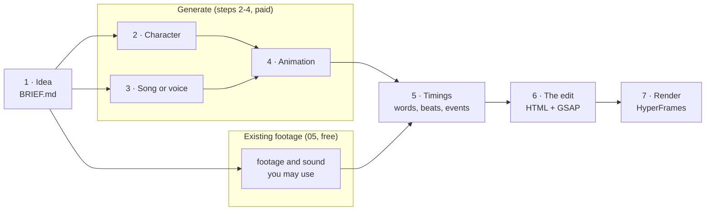

# 00. How it works

Overview of all 7 steps. Cost: $0 with existing footage, about $4.5 to $15.6 per pass when you generate the character. Prompts: [`prompts/`](../prompts/README.md). Output: an MP4, 1080x1920, 30 fps.

Claude Code drives every step. Steps 1 to 4 plan and make the media. Steps 5 to 7 put a motion-graphics edit on top and render it.

## The seven steps

| Step | Output | Chapter | Prompt | Cost |
|---|---|---|---|---|
| 1. Idea | `BRIEF.md` | [01-idea](01-idea.md) | [gen-00-idea](../prompts/generate/gen-00-idea.md) | free |
| 2. Character | sheet, one-face reference, `CHARACTER.md`, keyframes | [02-character](02-character.md) | [gen-01-character](../prompts/generate/gen-01-character.md), [gen-02-keyframes](../prompts/generate/gen-02-keyframes.md) | paid |
| 3. Song or voice | `lyrics.txt` or `script.txt`, a checked take | [03-song-or-voice](03-song-or-voice.md) | [gen-03-song](../prompts/generate/gen-03-song.md), [gen-06-talking](../prompts/generate/gen-06-talking.md) | paid |
| 4. Animation | one clip per scene | [04-animate](04-animate.md) | [gen-04-cut-song](../prompts/generate/gen-04-cut-song.md), [gen-05-animate](../prompts/generate/gen-05-animate.md), [gen-06-talking](../prompts/generate/gen-06-talking.md) | paid, most of the bill |
| 5. Timings | `transcript.json`, or events, beats and marks read from frames | [06-word-timing](06-word-timing.md) | [edit/02-word-timing](../prompts/edit/02-word-timing.md) | free |
| 6. The edit | `build/index.template.htm`, built into `index.html` | [07-the-edit](07-the-edit.md) | [edit/03-edit](../prompts/edit/03-edit.md), [edit/04-review](../prompts/edit/04-review.md) | your Claude plan |
| 7. Render | the MP4 | [08-render-and-qa](08-render-and-qa.md) | [edit/05-render](../prompts/edit/05-render.md) | free |

Footage and a song you may use replace steps 2 to 4 for free ([05-or-use-existing-footage](05-or-use-existing-footage.md)). [`prompts/00-brief.md`](../prompts/00-brief.md) fixes what appears on screen on either path. The three examples, [wing-it](../examples/wing-it/README.md), [spin-count](../examples/spin-count/README.md) and [handwash-song](../examples/handwash-song/README.md), take the free path and run steps 5 to 7 in full.



## Why the edit is code

| Layer | What it is | In wing-it |
|---|---|---|
| 1. Footage | the clip the viewer watches | `assets/wing_v.mp4` |
| 2. Sound | the song, the voice or the film's soundtrack | `assets/wing_a.mp3` |
| 3. Timings | sung words, beats, marks or story events | `events.json` |
| 4. The edit | HTML + CSS + a paused GSAP timeline | `build/index.template.htm` |

The edit is one HTML file. Claude Code writes it, lints it, reads snapshots of it and fixes it like any other code, and git keeps every version.

Everything that moves with the sound takes its time from layer 3. In handwash-song, `npm run build` inlines `transcript.json` into `index.html` through the template's `/*TRANSCRIPT*/[]` placeholder. In wing-it and spin-count, the events and marks are constants in the template. For a new song you regenerate the timings and adjust a few constants ([07-the-edit](07-the-edit.md)).

Layers 3 and 4 work the same whichever path made layers 1 and 2. The format only has to give the code something to animate: numbers, steps, words, events or a timer ([01-idea](01-idea.md)).

## How HyperFrames turns HTML into an MP4

[HyperFrames](https://github.com/heygen-com/hyperframes) (Apache-2.0, Node.js 22+ and FFmpeg) treats one HTML file as one video. This repo pins version 0.8.143. Three rules matter most.

**1. The root declares the canvas** with `data-*` attributes ([HTML schema](https://hyperframes.heygen.com/reference/html-schema)). Root `data-duration` is read before any script runs, so it must be a literal. From wing-it:

```html
<div id="root" data-composition-id="main" data-start="0" data-duration="32.5" data-width="1080" data-height="1920">
```

**2. Video is muted (or declares `data-has-audio`), sound is a separate `<audio>` with an `id`.** HyperFrames plays, pauses and seeks both from `data-start` and `data-duration`. Your script never touches them.

```html
<video id="footage" src="assets/wing_v.mp4" data-start="0" data-duration="29.96" data-track-index="0" muted playsinline></video>
<audio id="sound" src="assets/wing_a.mp3" data-start="0" data-duration="32.5" data-track-index="1" data-volume="1"></audio>
```

**3. All motion lives in one paused GSAP timeline**, registered on `window.__timelines` under the composition id:

```js
window.__timelines = window.__timelines || {};
const tl = gsap.timeline({ paused: true });
// every tween goes on tl
window.__timelines.main = tl;
```

The render goes one frame at a time ([determinism](https://hyperframes.heygen.com/concepts/determinism)):

```text
for frame in 0 .. 974                    (32.5 s x 30 fps = 975 frames)
    t = frame / 30                        integer frame clock, no wall clock
    each <video> shows its frame at t     frames extracted ahead of time by FFmpeg
    window.__timelines.main is seeked to t
    the page is captured as an image
FFmpeg encodes the images to H.264 and mixes every <audio> (and unmuted <video>) into AAC
```

Each frame depends only on its number, so a composition that stutters in the preview still renders cleanly. That holds only if the page follows the [rules](https://hyperframes.heygen.com/prompting/rules-and-anti-patterns):

- no `Date.now()`, `requestAnimationFrame`, `setTimeout` or `setInterval` driving visuals
- no unseeded `Math.random()` (a seeded generator such as mulberry32 is fine)
- no `fetch` during the render
- fixed frame size and fps, a finite length, one timeline registered synchronously

Break a rule and HyperFrames usually gives no error. To compare two renders of your own, use the determinism check in [08-render-and-qa](08-render-and-qa.md).

## What costs money

List prices as of 2026-10-09. Each chapter links its price pages.

| Step | Free route | Paid route |
|---|---|---|
| 1. Idea | Claude Code with your links and numbers | |
| 2. Character | existing footage ([05](05-or-use-existing-footage.md)) | Nano Banana Pro $0.134 per 1K/2K image; GPT Image 2 on fal $0.005 to $0.165 per image |
| 3. Song or voice | public-domain or CC audio; local TTS (Kokoro-82M through `npx hyperframes@0.8.143 tts`, needs a Python package) | Lyria 3 Clip $0.04, Lyria 3.5 or 3 Pro $0.08 per song; Eleven v3 or v4 $0.08 per 1,000 characters |
| 4. Animation | none | Seedance 2.5 about $0.10 to $0.57 per second; Kling v3 $0.084 to $0.168 per second; OmniHuman 1.5 $0.16 per second |
| 5. Timings | `npx hyperframes@0.8.143 transcribe` or `beats`, locally; events and marks read from frames | Groq `whisper-large-v3` $0.111 per hour of audio, 10 s minimum ([docs](https://console.groq.com/docs/speech-to-text)) |
| 6. The edit | Claude Code, on your Claude plan | |
| 7. Render | HyperFrames, locally; a few minutes for 30 s | HeyGen's hosted `cloud render` (needs `auth login`) |

GSAP is free, including commercial use, under its own [Standard License](https://gsap.com/standard-license), which is not an OSI license. The examples cost nothing, apart from about $0.001 of optional Groq transcription for handwash-song.

### Estimated cost of one video

A 30-second singing mascot, one pass with no rejected takes:

| Step | Choice | Calculation | USD |
|---|---|---|---|
| Base image, 2 sheets, 6 scene keyframes | Nano Banana Pro, 2K | 9 x $0.134 | 1.21 |
| Song, 3 takes | Lyria 3.5 (or 3 Pro) | 3 x $0.08 | 0.24 |
| Singing, 30 s | Seedance 2.5: Picsart 480p / Picsart 720p / fal 720p | 30 x $0.1028 / 30 x $0.231 / 30 x $0.473 | 3.08 / 6.93 / 14.19 |
| Timings, edit, render | Groq or local; HyperFrames | | 0.00 |
| **Total** | | | **about $4.5 to $15.6** |

Picsart lists image-to-video rates for Seedance and no separate reference-to-video price.

A talking coach with three moves comes to about $3.8 per pass: 4 concept images, 5 keyframes, 15 s of Kling v3 Standard moves, 10 s of OmniHuman lip-sync, a short Eleven v3 script and a Lyria 3 Clip.

Animation is about 70 to 90 percent of both totals. Budget two to three times the single pass once retakes are counted.

## How Claude Code reaches the paid models

You log into a CLI or MCP server yourself, and Claude Code calls the models through it. Never paste a key into a prompt or a committed file. The generation prompts stop before every paid call, state the price, and log each take in `costs.csv`.

| Service | Connect | Billing |
|---|---|---|
| [Picsart gen-ai CLI](https://picsart.com/cli/) ([repo](https://github.com/PicsArt/gen-ai-cli), MIT) | `npm install -g @picsart/gen-ai` (Node 22+), `gen-ai login`, then `gen-ai generate -m <model> ...`. Or MCP: `claude mcp add --transport http picsart-gen-ai https://api.picsart.com/gen-ai/mcp`, then `/mcp` ([guide](https://picsart.github.io/picsart-mcp-cli-docs/guide/integrations/claude-code)) | credits; Pro plan $15/month or $10.50/month yearly for 500 credits ([pricing](https://picsart.com/pricing)) |
| [Higgsfield](https://higgsfield.ai) | MCP at `https://mcp.higgsfield.ai/mcp` (OAuth), or `npx skills add higgsfield-ai/skills` and `higgsfield auth login` ([help](https://higgsfield.ai/creator-hub/help-center/integrations/how-do-i-access-higgsfield-via-cli)) | MCP and CLI spend plan credits, even on "unlimited" plans; the API is a separate USD balance, $5 minimum top-up ([help](https://higgsfield.ai/creator-hub/help-center/integrations/what-is-the-higgsfield-api)) |
| [fal](https://fal.ai) | MCP server ([docs](https://fal.ai/docs/model-apis/mcp)) or plain HTTP with `FAL_KEY` | per output second or image |

- **Picsart**: the [catalog](https://picsart.github.io/picsart-mcp-cli-docs/reference/catalog) lists the models these docs price. Pass `--no-save-to-drive`, or outputs go to Picsart Drive. Cap spending with `--max-cost <credits>`, get agent-readable output with `--json`, check a price with `gen-ai pricing <model>`. Model IDs include `gpt-image-2`, `gemini-3-pro-image`, `kling-v3`, `seedance-2.5`, `bytedance-omnihuman-v1.5`, `eleven-v3`, `lyria-3-pro` and `lyria-3.5`.
- **Higgsfield**: check the pricing page before you buy.
- **fal** endpoints: `fal-ai/nano-banana-pro/edit`, `bytedance/seedance-2.5/reference-to-video`, `fal-ai/kling-video/v3/pro/image-to-video`, `fal-ai/bytedance/omnihuman/v1.5`.

## Claude Code and HyperFrames

This repo's skill, [`skills/character-video`](../skills/character-video/SKILL.md), runs the whole pipeline with stop points. The examples need only plain Claude Code and `npx hyperframes@0.8.143`.

HyperFrames also ships a Claude Code plugin ([plugins guide](https://hyperframes.heygen.com/guides/plugins)):

```bash
claude plugin marketplace add heygen-com/hyperframes
claude plugin install hyperframes@hyperframes
```

Run `/reload-plugins`, then name the tool in your request: "Using /hyperframes:hyperframes, ...". Without the plugin, `npx skills add heygen-com/hyperframes` installs the skills.

HyperFrames telemetry is on by default. Turn it off with `HYPERFRAMES_NO_TELEMETRY=1` or `npx hyperframes@0.8.143 telemetry disable` ([CLI reference](https://hyperframes.heygen.com/packages/cli)).

## Pitfalls

All of them, with fixes, in [gotchas.md](gotchas.md):

- A timeline that never registers renders as a still frame, with no error.
- An `<audio>` without an `id` renders silent.
- Never play, pause or seek media from script: HyperFrames does it from the `data-*` attributes.
- The docs disagree in places: trust `--help` of the pinned version.
- With ffmpeg 8.1.2 (gyan.dev Windows build), every render has an 8 px black strip at the right edge. `npm run render` repairs it.
- The `/hyperframes` skill runs `npx hyperframes usage --json`, which reads your Claude Code credentials.
