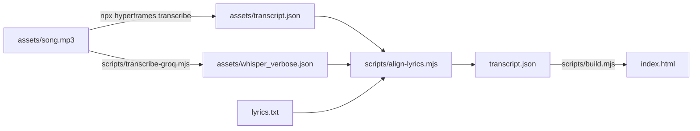

# 06. Word timing

Step 5 of 7. Free locally, or about a tenth of a cent per 30 s song on Groq. Prompt: [`prompts/edit/02-word-timing.md`](../prompts/edit/02-word-timing.md). Output: `transcript.json`.

Every effect that follows the song needs to know when each word is sung. This step writes `transcript.json`: a start and end time for every word. For a generated song, the same aligner is the take check ([03-song-or-voice.md](03-song-or-voice.md#6-qa-did-the-model-sing-or-say-every-word)).

A video without words uses other clocks: beats and picture marks ([spin-count](#timings-without-words-beats-and-visual-marks)) or story events ([wing-it](#story-events-stepping-through-frames)).



## The rule: timings from the model, words from your lyrics

Speech recognition is good at *when* a word happens and unreliable at *which* word, especially in singing. You already have the words, so take the times from the transcription and the text from `lyrics.txt`.

## Options

| Route | Cost | Notes |
|---|---|---|
| `npx hyperframes transcribe` | free, local | Parakeet or whisper.cpp |
| Groq `whisper-large-v3` via `scripts/transcribe-groq.mjs` | $0.111 per audio hour, 10 s minimum per request | 25 MB upload on the free tier, 100 MB on the dev tier ([docs](https://console.groq.com/docs/speech-to-text)) |

Other services with per-word times: OpenAI [`whisper-1`](https://developers.openai.com/api/docs/guides/speech-to-text) (the only OpenAI transcription model with `timestamp_granularities[]`), ElevenLabs [Scribe v2](https://elevenlabs.io/docs/api-reference/speech-to-text/convert) ($0.22 per hour) and [WhisperX](https://github.com/m-bain/whisperX) (local, Python).

### Local: `npx hyperframes transcribe`

```bash
npx hyperframes@0.8.143 models install parakeet     # once
npx hyperframes@0.8.143 transcribe examples/handwash-song/assets/song.mp3 --engine parakeet --language en
# writes examples/handwash-song/assets/transcript.json
node scripts/align-lyrics.mjs examples/handwash-song --heard examples/handwash-song/assets/transcript.json
```

Pass `--heard`, or `align-lyrics.mjs` prefers the committed `assets/whisper_verbose.json`.

- Flags: `--engine auto|parakeet|whisper`, `--model` (whisper, `tiny.en` to `large-v3`, default `small.en`), `--language`, `--to srt|vtt`.
- The `.en` models translate non-English audio into English. Set `--model` and `--language` explicitly.
- If `npx hyperframes@0.8.143 doctor` reports whisper-cpp missing, use `--engine parakeet` (a model of about 640 MB, per the [CLI reference](https://hyperframes.heygen.com/packages/cli)).
- For whisper on songs, HyperFrames advises `medium.en`, stripping `♪` tokens, and treating a transcript over 20 percent `♪` as failed ([transcript-handling.md](https://github.com/heygen-com/hyperframes/blob/main/skills/media-use/audio/references/captions/transcript-handling.md)).

> [!WARNING]
> **Never pass `--dir` with an example folder.** Version 0.8.143 writes `transcript.json` into that folder and puts the raw words into the first `const script = [ ... ];` or `const TRANSCRIPT = [ ... ];` of every `.html` file under it ([normalize.ts](https://github.com/heygen-com/hyperframes/blob/main/packages/cli/src/whisper/normalize.ts)). That overwrites the corrected `transcript.json` and `index.html`. `npm run align` then `npm run build` repairs both.

### Groq: `scripts/transcribe-groq.mjs`

The script reads the key from `GROQ_API_KEY`, never prints it, and saves the raw answer.

```bash
# bash / zsh (overwrites the committed assets/whisper_verbose.json)
GROQ_API_KEY=... npm run transcribe
```

```powershell
$env:GROQ_API_KEY="..."; npm run transcribe
```

The same request with curl:

```bash
curl https://api.groq.com/openai/v1/audio/transcriptions \
  -H "Authorization: Bearer $GROQ_API_KEY" \
  -F file=@assets/song.mp3 \
  -F model=whisper-large-v3 \
  -F response_format=verbose_json \
  -F "timestamp_granularities[]=word" \
  -F language=en
```

The handwash answer is committed, so the rest of the pipeline runs without a key. Behind a proxy, set `NODE_USE_ENV_PROXY=1` next to `HTTPS_PROXY`: Node's built-in `fetch` ignores `HTTPS_PROXY` otherwise.

## What Whisper heard

The handwash `lyrics.txt`, sung twice:

```text
Wash hands well each day,
to keep germs away.
Scrub with soap and water
and be on your way.
```

`whisper-large-v3` returned 39 words for 38 sung ones. "Wash hands well" came back as "Wash and sell" in both passes, and a stray "you" followed the music.

- **The same mistake both times.** It comes from how the model hears this recording, so the fix belongs in the text.
- **The wrong words have the right timings.** "and" starts at 3.14 s, exactly where "hands" starts.
- **A word out of nothing.** The trailing "you" at 30.16 s sits on the silent end card. The last sung word ends at 24.48 s.

On a generated song the same comparison catches the opposite case: when a take skips a word, the lyrics are right and the take is wrong.

## How `align-lyrics.mjs` works

```bash
npm run align                                                    # examples/handwash-song
node scripts/align-lyrics.mjs examples/handwash-song --dry-run   # report only
```

1. **Read both lists.** Lyrics come from `lyrics.txt`, one sung line per line, skipping blank lines, `#` comments and labels like `[Chorus]`. Heard words come from `assets/whisper_verbose.json`, else `assets/transcript.json`, or `--heard <file>`: OpenAI/Groq `words[]`, openai-whisper `segments[].words[]` or `[{text, start, end}]`. Tokens with no letters or digits (`♪`) are ignored.
2. **Compare** in lower case, letters and digits only.
3. **Align** with word-level edit distance, the idea behind `diff`. Each lyric word is a *match*, *corrected* (heard timing, lyric text) or *not heard* (`interpolated` between neighbours). Extra heard words are dropped and listed.
4. **Check** that times only go forward, then write `transcript.json`.

The handwash report:

```text
  #    time  sung                       heard
  1    2.98  Wash hands well each day   Wash [and] [sell] each day
  2    5.34  to keep germs away         to keep germs away
  3    8.70  Scrub with soap and water  Scrub with soap and water
  4   11.14  and be on your way         and be on your way
  5   14.36  Wash hands well each day   Wash [and] [sell] each day
  6   16.56  to keep germs away         to keep germs away
  7   19.72  Scrub with soap and water  Scrub with soap and water
  8   21.98  and be on your way         and be on your way +you
  [x] heard x instead   (-) not heard   +x heard, not in lyrics

corrected (text from lyrics, time from the transcription):
    3.14  #1   hands        heard "and"
    3.84  #2   well         heard "sell"
   14.70  #20  hands        heard "and"
   15.18  #21  well         heard "sell"
not heard (time interpolated, listen to the take): none
dropped (heard, not in lyrics):
   30.16  "you" after the last sung word (24.48 s)

38 words: 34 matched, 4 corrected, 0 interpolated; 1 heard word(s) dropped
singing 2.98 s -> 24.48 s (21.50 s)
LINES (word index range of each lyric line): [[0, 4], [5, 8], [9, 13], [14, 18], [19, 23], [24, 27], [28, 32], [33, 37]]
```

The last line is the `LINES` array for the composition ([07-the-edit.md](07-the-edit.md)).

**Read the "not heard" list.** An interpolated time is a guess. On a generated song it usually means the take skipped the word: generate another take. If the word is sung, listen and set its time by hand.

## `transcript.json`

```json
[
 { "text": "Wash", "start": 2.98, "end": 3.14 },
 { "text": "hands", "start": 3.14, "end": 3.84, "heard": "and" },
 ...
]
```

| Field | Meaning |
|---|---|
| `text` | the word from `lyrics.txt`, outer punctuation removed |
| `start`, `end` | seconds from the start of `song.mp3` |
| `heard` | only when the transcription heard a different word |
| `interpolated` | only when the word was not heard and its time was spread between neighbours |

Word order equals lyric order, so index 19 is always the first word of the second pass, and the composition relies on that. `npm run build` copies only `text`, `start` and `end` into `index.html`.

## Quick checks before you build

```bash
# word index, text and start time, eight per row
node -e "const t=require('./examples/handwash-song/transcript.json'); t.forEach((w,i)=>process.stdout.write(i+':'+w.text+'@'+w.start+(i%8==7?'\n':'  ')))"
```

- The word count equals the lyric word count.
- The first word starts where the singing starts (2.98 s here) and the last ends where it stops (24.48 s).
- Nothing is past the end of the audio (30.89 s here; `npm run probe` shows it).

## Timings without words: beats and visual marks

`examples/spin-count` has music and no lyrics. Its effects follow the beat and ten moments in the picture. The times are constants in the template, with their raw data committed next to it.

### Beats

```bash
npx hyperframes@0.8.143 beats examples/spin-count
# ✓ Wrote 69 beats → beats/assets/music_cut.mp3.json (bpm 188, high)
```

It analyzes the `<audio>` marked `data-timeline-role="music"` and writes `beats/<audio path>.json`, leaving `index.html` alone:

```json
{ "version": 1, "audio": "assets/music_cut.mp3", "beats": [{ "time": 0.224, "strength": 0.65 }, ...] }
```

The example reduces that to a first beat and a step:

```bash
node -e "const b=require('./examples/spin-count/beats/assets/music_cut.mp3.json').beats.map(x=>x.time); console.log(b.length, b[0], ((b.at(-1)-b[0])/(b.length-1)).toFixed(4))"
# 69 0.224 0.3191
```

The template uses `BEAT0 = 0.22, BEAT = 0.3185`, so the last pulse lands 0.043 s early, a little over one frame. A grid suits a steady tempo like this one. For music that drifts, inline the beat times.

### Marks read from the picture

A mark is a frame where something visible happens: his back turns to the camera, a foot lands. Claude Code cannot watch video, but it reads images, so turn the clip into contact sheets and narrow down.

```bash
# from examples/spin-count, after npm run fetch:spin
mkdir -p assets/frames
# 1. overview: 4 frames per second, 16 per sheet; sheet k (from 1), tile n (from 0) is (k - 1) * 4 + n / 4 s
ffmpeg -i assets/source/313047_large.mp4 -vf "fps=4,scale=180:-2,tile=8x2" assets/frames/sheet_%02d.png
# 2. close-up: every source frame (24 fps) from 1.6 s; tile n is 1.6 + n / 24 s
ffmpeg -ss 1.6 -t 0.6 -i assets/source/313047_large.mp4 -vf "scale=180:-2,tile=8x2" -frames:v 1 assets/frames/near_1.6.png
```

Keep frames under `assets/`, where `.gitignore` covers images.

Write marks in source time and convert in one place. `boy.mp4` plays at 0.85x, so the template does `SPINS = [...].map(t => +(t / 0.85).toFixed(2))`. The record is [`spins.json`](../examples/spin-count/spins.json).

**Check every mark with a frame grab before the numbers go on screen.** In the example, marks 1 and 4 land on a profile frame mid-turn, and a second pass found two unmarked back views at about 1.35 s and 13.3 s of the source (`unmarked` in `spins.json`).

<details>
<summary>A request for Claude Code that finds the marks</summary>

```text
In examples/my-video, assets/source/clip.mp4 is the footage. I want a mark
every time <the event, for example: his back faces the camera>.
1. Make overview contact sheets with
   ffmpeg -i assets/source/clip.mp4 -vf "fps=4,scale=180:-2,tile=8x2" assets/frames/sheet_%02d.png
   Read every sheet and list each candidate with its time
   ((sheet - 1) * 4 + tile / 4 seconds) and what the tile shows.
2. For each candidate, make a close-up sheet of every source frame for
   0.6 s around it, and pick the frame where <the event> peaks.
3. Write spins.json with the source times, and show me a table: mark,
   time, what the frame shows, how sure you are. List anything that looks
   like the event but that you did not mark, and why.
4. Extract the frame at each final time into one sheet so I can check them.
Do not edit the template yet.
```

</details>

## Story events: stepping through frames

`examples/wing-it` has no words and no beat. Its edit is a pre-flight checklist whose chips tick or cross as the story reaches them: the seatbelts fail, the rocket lights, the parachute turns out to be an umbrella.

**1. Overview.** Write the story as beats with rough times ("about 3.5: cut to the rocket in the barn"). Work on the cut, whose clock the edit runs on, and note the film time (cut time plus 82.0 s).

```bash
# from examples/wing-it, after npm run fetch:wing
mkdir -p assets/frames
# 4 frames per second of the cut, 16 per sheet; sheet k, tile n is (k - 1) * 4 + n / 4 s
ffmpeg -i assets/wing_v.mp4 -vf "fps=4,scale=135:-2,tile=8x2" assets/frames/sheet_%02d.png
```

**2. Close-up.** Make a sheet of every frame around each beat and pick the frame:

```bash
# every frame from 21.4 s at 30 fps: tile n is 21.4 + n / 30 s
ffmpeg -ss 21.4 -t 0.6 -i assets/wing_v.mp4 -vf "scale=135:-2,tile=6x3" -frames:v 1 assets/frames/near_21.4.png
```

Here the umbrella is open in tile 7 (21.63 s) and inside out in tile 8 (21.67 s). Then pick where the edit reacts:

| React | When | Example |
|---|---|---|
| on the cut | the new shot is the event | IGNITION at 3.5 s, the first frame of the rocket in the barn |
| on the action | it happens inside a shot | each gadget within about 0.1 s of its first frame |
| a little after | the viewer needs a moment | PARACHUTE at 22.0 s, about 0.33 s after the flip |

ffmpeg's scene score finds the cuts ([05-or-use-existing-footage.md](05-or-use-existing-footage.md#a-916-cut-shot-by-shot)). Action inside a shot needs the close-up sheets.

**3. Write `events.json`.** [`events.json`](../examples/wing-it/events.json) holds six `checklist` items, seven `gadgets` and the other `cues` (countdown, shakes, cards, outro). Each event has its time in the cut (`t`), in the film (`film_s`) and what the frame shows:

```json
{ "n": 5, "item": "PARACHUTE", "t": 22.0, "film_s": 104.0, "result": "fail", "frame": "the umbrella is inside out; it flips between 21.6 and 21.8" }
```

The template holds the same numbers in `ITEMS`, `GADGETS` and its cue calls. Nothing generates them from the file, so change both together.

**4. Check every event with a frame grab.** Put the frame at each final time on one sheet and read it.

<details>
<summary>A request for Claude Code that finds the events</summary>

```text
In examples/my-video, assets/footage.mp4 is the cut. The edit is a <checklist,
plan, rule list> that the story <ticks off, breaks>. Items: <list>.
1. Make overview sheets with
   ffmpeg -i assets/footage.mp4 -vf "fps=4,scale=135:-2,tile=8x2" assets/frames/sheet_%02d.png
   Read every sheet and write the story as a list of beats with rough times
   ((sheet - 1) * 4 + tile / 4 seconds).
2. For each item, find the beat that decides it. Make a close-up sheet of every
   frame for 0.6 s around it and pick the frame. Say whether the event is a cut
   or an action inside a shot, and where the chip should react.
3. Write events.json: n, item, t (seconds in the cut), source time, result,
   and what the frame shows. Show me the table.
4. Extract the frame at each final time into one sheet so I can check them.
Do not edit the template yet.
```

</details>
