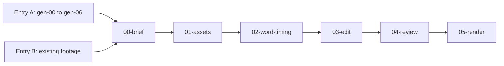

# Prompts

The pipeline as separate prompts. Paste them into Claude Code from the repo root, in order. Every prompt stops for you at least once.

There are two ways in, and they meet at the brief:

- **Entry A, generate** (`generate/`): idea, character, keyframes, song or voice, animation. These steps call paid models. Each prompt states the price, waits for your OK before every paid call, and logs every take in `costs.csv`. The prompts follow the provider docs linked in each file; expect to tune them on your first video.
- **Entry B, existing footage**: a clip and a song you may use. No generation, no cost. All three examples take this way in.

## Entry A: generate

| Prompt | Step | Model (list price, 2026-10-09) | Stops for you |
|---|---|---|---|
| [gen-00-idea](generate/gen-00-idea.md) | 1. idea | none, Claude Code only | after 3 scored formats, after `BRIEF.md` |
| [gen-01-character](generate/gen-01-character.md) | 2. character | Nano Banana Pro ($0.134 per 1K/2K image) or GPT Image 2 | after 4 pitches, after the base image, before each paid call |
| [gen-03-song](generate/gen-03-song.md), step 1 | 3. lyrics | none | after `lyrics.txt` and its timing table |
| [gen-02-keyframes](generate/gen-02-keyframes.md) | 2. keyframes | Nano Banana Pro edit, `ref.png` as the reference | after `STORYBOARD.md`, after the first 2 keyframes |
| [gen-03-song](generate/gen-03-song.md), steps 2 to 4 | 3. song takes and the word check | Lyria 3 Clip ($0.04, always 30 s) or Lyria 3.5 ($0.08); ElevenLabs Music when scene lengths must be exact | before each batch of takes, after 6 takes |
| [gen-04-cut-song](generate/gen-04-cut-song.md) | 4. cut the song per scene | ffmpeg, no cost | |
| [gen-05-animate](generate/gen-05-animate.md) | 4. singing clips | Seedance 2.5 reference-to-video with an audio reference ($0.10 to $0.57 per second) | after `PROMPTS.md`, after the pilot, before each batch |
| [gen-06-talking](generate/gen-06-talking.md) | 3 and 4 for a talking character | Eleven v4 ($0.08 per 1,000 characters) or Gemini TTS for the voice; OmniHuman 1.5 or Kling AI Avatar v2 for the lip-sync | after `script.txt`, before each paid call, after the first talking clip |

Rules every generation prompt follows (detail in [docs/02-character.md](../docs/02-character.md) and [docs/04-animate.md](../docs/04-animate.md)):

- **Pick and approve before you pay.** Pitch the idea and the character, wait for a choice, show the price, stop after the first output.
- **Identity is text plus image.** The appearance block and the style sentence from `CHARACTER.md` go word for word into every image and video prompt.
- **The sheet is never a video input.** Models get `ref.png` for identity and one keyframe per scene as the picture to animate.
- **Words are checked before pictures move.** Every song take and every voice line is transcribed blind and diffed against the text with `scripts/align-lyrics.mjs`.
- **No lettering in generated footage.** Every prompt ends with "No on-screen text, lettering or logos". All type comes from the edit, spelled right and timed to the word.

The agent calls the models through an aggregator CLI or MCP server that you log into yourself: Picsart `gen-ai`, Higgsfield or fal ([docs/00-how-it-works.md](../docs/00-how-it-works.md#how-claude-code-reaches-the-paid-models)). Keys and logins stay with you. Never paste a key into a prompt.

Short quotes from Picsart's MIT-licensed skills and Google's CC BY 4.0 docs keep their attribution and link.

## Brief and edit (both entries)

| # | Prompt | Step | Stops for you |
|---|---|---|---|
| 0 | [00-brief](00-brief.md) | entry B: license checks, `lyrics.txt`, `BRIEF.md`. Entry A: terms, AI labels and an "On screen" section in `BRIEF.md` | approve the brief |
| 1 | [01-assets](edit/01-assets.md) | footage and song files: download, crop, re-encode, probe (entry A: join the scene clips) | approve the crop |
| 2 | [02-word-timing](edit/02-word-timing.md) | 5. transcribe, align to your lyrics, report mismatches | approve the timings |
| 3 | [03-edit](edit/03-edit.md) | 6. build the HyperFrames composition, lint, snapshot | before any render |
| 4 | [04-review](edit/04-review.md) | 6. separate reviewer pass that only reports | decide what to fix |
| 5 | [05-render](edit/05-render.md) | 7. draft render, right-edge fix, determinism check, delivery render, probe | approve the draft |

The edit prompts take their commands and reference numbers from `examples/handwash-song`. For a video without words, replace `02-word-timing` with the [beats and marks](../docs/06-word-timing.md#timings-without-words-beats-and-visual-marks) or [story events](../docs/06-word-timing.md#story-events-stepping-through-frames) method from docs/06, and take the template from `examples/spin-count` or `examples/wing-it`.

## Conventions

- The project folder is `examples/my-video`. Change it in the prompt for another name.
- Text in `<ANGLE BRACKETS>` is yours to fill in.
- HyperFrames is pinned: `npx hyperframes@0.8.143`. Telemetry is off with `HYPERFRAMES_NO_TELEMETRY=1`.
- Media never goes into git. `.gitignore` covers media under `examples/*/assets/` (subfolders included), `renders/` and `snapshots/`. Run `git status` before you commit.

Before the first prompt, run one example once ([wing-it](../examples/wing-it/README.md), [spin-count](../examples/spin-count/README.md) or [handwash-song](../examples/handwash-song/README.md)). If it renders, the toolchain works and any later problem is in your material.

To run everything as one command with the same stop points, install the skill in [`skills/character-video`](../skills/character-video/SKILL.md).
